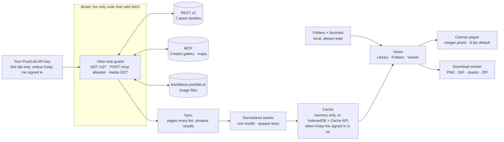
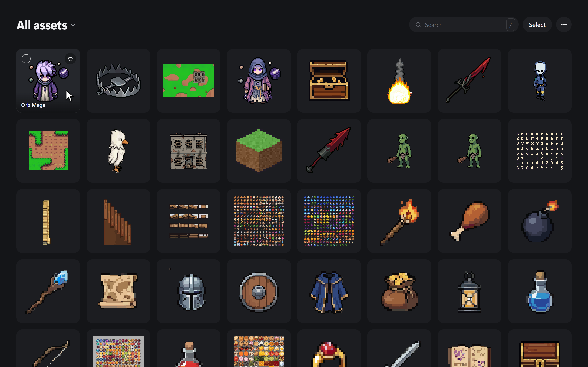
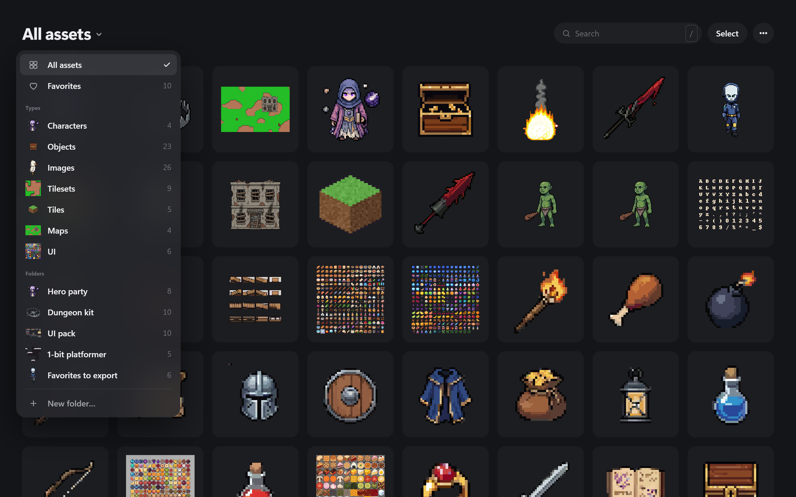
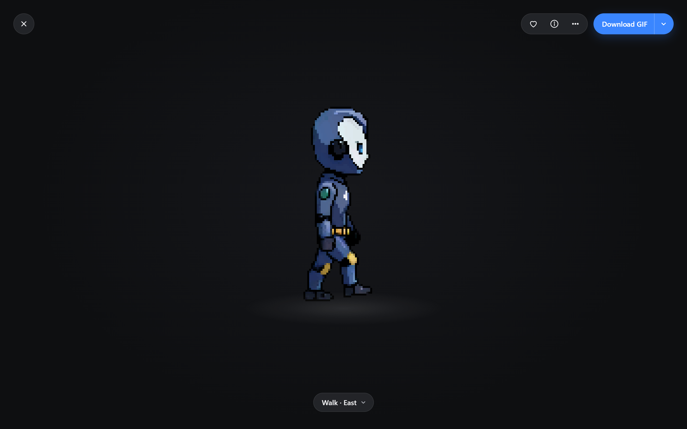
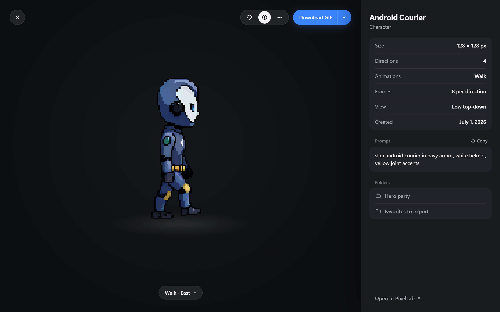

# Vitrine

**An unofficial, view-only gallery for your PixelLab assets: every sprite, tileset and map in one calm, pixel-perfect library. It runs entirely in your browser with your own API key.**

> **Unofficial.** Vitrine is not made by, affiliated with, or endorsed by PixelLab. It uses no PixelLab logo, mascot, colors or screenshots.
>
> **"Vitrine"** (French for a museum display case) is a provisional name. The owner picks the final one.

## Status

| | |
|---|---|
| Research and design | **Simplicity redesign** (2026-10-19): the owner rejected the earlier mockups as too busy. Three simplicity spikes (research 10–12) and three static concepts led to [design 08](docs/design/08-simplicity-redesign.md), "Just the Art". It now awaits owner review. In total: 13 research docs, reviews R1–R5, 9 design docs, 3 simple concepts and 4 earlier interactive mockups |
| App code | **None yet.** It will be scaffolded at the project root, beside `docs/` and `mockups/`, with a local `git init`; CI (GitHub Actions) is added once a remote exists |
| Next step | **Owner review of [design 08](docs/design/08-simplicity-redesign.md)**, then **Phase 0**: about half a day of owner-run checks with a real API key ([plan §2](docs/design/06-implementation-plan.md)). Phase 1 tasks that need no Phase 0 result can start in parallel on synthetic fixtures, with every gated value at its safe default ([plan §3.1](docs/design/06-implementation-plan.md)) |

## What it is

- **One library for everything PixelLab lets you list.** Characters, Objects (including map objects), Images (Creator gallery), Tilesets, Tiles, Maps and UI share one search, one sort and one scope menu. PixelLab's own site spreads them over 7+ separate libraries.
- **Crisp at every size.** Sprites are drawn at a whole number of device pixels. Art bigger than its cell is shown whole and smoothly fitted. Nothing is cropped or scaled with CSS transforms.
- **Playback that matches PixelLab.** It plays at 8 fps by default, with animations, directions and states one chip away, and speed, frame step, loop, zoom and five backdrops one menu away.
- **Folders and favorites.** They are local and many-to-many, open as an overlay, and have a JSON backup.
- **Every download type.** PNG (original bytes at 1×, or an N× upscale), GIF, sprite sheet + Aseprite JSON, all frames, PixelLab originals, and uncapped multi-asset or whole-account ZIPs.
- **Hand-offs, not edits.** Anything that creates, edits or spends goes through a labelled "Open in PixelLab ↗" link. Tools that can cost money say "May use PixelLab credits".
- **Desktop and mobile.** It covers phone portrait and landscape through ultrawide, with touch, mouse, keyboard and screen reader. There are no hover-only actions, and the baseline is WCAG 2.2 AA.
- **No backend, and your key stays in your browser.** The key is sent only to `api.pixellab.ai`. It is kept for this tab only unless you choose "Keep me signed in", and it never appears in URLs, logs or downloads.

## How the app works

You paste your PixelLab API key. Vitrine checks it with the free, read-only `GET /v2/balance` call and starts syncing right away. It pages through every REST v2 list (seven asset families). Over MCP it reads the two families that only MCP exposes: Creator gallery images and maps. Each page is converted into one shared asset model, keyed by an opaque hash instead of the raw ID, and goes into the grid as soon as it arrives, so nothing ever blocks. Animation frames load only when you open an asset or a capped preview plays. One canvas component draws all the art on a shared ticker, and downloads are encoded and zipped in a worker that loads only when needed.



**View-only is enforced in code, not by convention**
- One fetch wrapper is the only network code. It attaches the key only for `https://api.pixellab.ai`. It allows `GET /v2/*`, `POST /mcp` and unauthenticated media GETs to allowlisted hosts, and refuses anything else before it is sent.
- The MCP client calls only an allowlist: `list_images`, `get_image` (Creator gallery refs only, behind a regex), `list_maps`, `view_map` and a few read-only getters. Once per session it checks PixelLab's tool annotations and switches a feature off if they change. It never calls `list_projects` (whose response embeds a credentialed git URL) or `get_map_object` (which can save).
- End-to-end tests assert zero non-GET `/v2` requests and zero MCP calls outside the allowlist.

**Not in the public API:** fonts, VFX "My effects", portraits, talking animations, uploads and Game Builder projects. Instead of fake types, the app shows one honest note that links to PixelLab.

**CORS verdict (live header captures, 2026-10-18): feasible with no proxy.** The REST v2 and MCP endpoints reflect any origin, allow credentials, and cache preflights for 600 s. Media on `backblaze.pixellab.ai` sends `Access-Control-Allow-Origin: *` with a one-year cache. There are two exceptions. The Creator gallery's presigned S3 `download_url` has no CORS, so the app uses `get_image`'s inline frames instead. `Retry-After` is not exposed, so the app backs off blindly with jitter. This behavior is undocumented and could be tightened. The fallback order is: ask PixelLab, then a Tauri desktop wrapper, then a proxy each user deploys for themselves. A shared proxy that sees everyone's keys is never acceptable. Details: [research 02](docs/research/02-browser-integration-and-security.md), [R1](docs/reviews/R1-research-cross-review.md).

## Recommendation

### Design: "Just the Art" (simplicity redesign)

The owner rejected every earlier mockup as too busy: a sidebar full of folders, a top bar full of buttons and a dense viewer. The redesign follows iOS Photos and Unsplash: the art fills the screen, and everything else is one labelled menu away. The full spec is [design 08](docs/design/08-simplicity-redesign.md); its rulings are S-1 to S-17 in the [decision log](docs/design/00-decision-log.md).

- **Base: Concept 1 "Just the Art"** ([mockups/simple/1-just-the-art/](mockups/simple/1-just-the-art/README.md)).
  - **First screen, 4 controls:** "All assets ▾" (the title switches between all assets, Favorites, the 7 types and every folder), Search (`/`), Select and "…".
  - **Detail, 5 controls + 1:** ✕, ♡, ⓘ, "…" and "Download GIF ▾", plus a "Walk · East ▾" chip only for assets with a choice of animation, direction or state. The asset name shows briefly on open, then fades. ⓘ opens a drawer with an Apple-style grouped list.
- **Borrowed from Concept 2** ([mockups/simple/2-home-screen/](mockups/simple/2-home-screen/README.md)): a quiet name under each tile, one right-click / long-press menu (Open, Favorite, Add to folder…, Download…, Select), and folders that open as an overlay.
- **Concept 3** ([mockups/simple/3-library-tiles/](mockups/simple/3-library-tiles/README.md)): its category tiles are kept only as a possible future overview screen.
- **Rules:** every hidden action is also in a labelled menu (nothing is hover-only or gesture-only). Selection swaps the top controls for a floating bottom bar (count, Download, Add to folder, Favorite, ✕). Speed, frame step, zoom, backdrop and the extra download formats live in menus.
- **Unchanged:** scope (01), behaviour, data and download semantics (02), architecture and security (05) and the plan (06).









**Earlier recommendation, superseded.** The "Quiet Studio, lifted" hybrid combined option A's shell with the best parts of B and C, after two mockup reviews ([R3a](docs/reviews/R3a-mockup-ux-review.md), [R3b](docs/reviews/R3b-mockup-visual-a11y-review.md)). Its layout and viewer controls are replaced by 08. Its tokens and accessibility invariants ([07](docs/design/07-recommended-design.md) §5, §7) remain the baseline until they are retuned.

### Implementation

| Concern | Choice | Why |
|---|---|---|
| Build | **Vite 8** (8.3.x) + `@sveltejs/vite-plugin-svelte` | Stable since 2026-03-12; Rolldown only; fewest moving parts |
| UI | **Svelte 5** (5.57.x), runes, `$state.raw` for asset arrays | A minimal app measured 15.5 KB gzip; no SSR, no SvelteKit |
| Types | **TypeScript ~6.0.3, pinned** | `latest` is TS 7, which svelte-check supports only through an opt-in dual install |
| Styling | **Plain CSS**: `@layer`, nesting, OKLCH, `light-dark()`, container queries | All Baseline in 2026; no Tailwind toolchain |
| Local data | **idb-keyval** (0.6 KB) for folders, favorites and snapshots; Cache API for image bytes | Filtering happens in memory |
| Icons and type | **@lucide/svelte** deep imports; system font stacks | ~0.4 KB per icon; 0 KB of fonts; CSP-clean |
| Downloads | **client-zip** (streaming ZIP) + **gifenc** (vendored), loaded lazily in a worker | ~7 KB gzip, loaded on first download |
| Routing, MCP | ~25-line hash router; ~40-line JSON-RPC client over `fetch` | The official MCP SDK costs 88–92 KB gzip |
| Tests | Vitest + Playwright against a mocked API; svelte-check; axe | No key or credits needed in CI |
| Budget | Initial JS ≤ 60 KB gzip; download code ≤ 10 KB, lazy | Enforced in CI |

**Vite+ is the fallback, not the base.** Vite+ is MIT-licensed, reached 1.0 on 2026-09-28 and builds Svelte apps. In a local smoke test of 1.3.0, though, `vp lint` missed an unused variable in a `.svelte` file and `vp fmt` skipped `.svelte` files entirely. A Svelte project would still need svelte-check and Prettier. Vite+ wraps the same Vite 8.3.4 and reads the same `vite.config.ts`, so switching later costs nothing ([research 07](docs/research/07-tech-stack-and-architecture.md)).

**Hosting with real headers.** The app is a static build on Cloudflare static assets, with a `public/_headers` file (Netlify reads the same format). GitHub Pages is rejected because it can't send headers, and a `<meta>` CSP ignores `frame-ancestors`. Art is fetched through `connect-src` and drawn on canvas, so `img-src` needs no remote host. The host and canonical URL are the owner's call ([05 §13](docs/design/05-architecture.md)).

```text
Content-Security-Policy: default-src 'none'; script-src 'self'; style-src 'self'; img-src 'self' blob:; connect-src https://api.pixellab.ai https://backblaze.pixellab.ai; font-src 'self'; manifest-src 'self'; worker-src 'self'; base-uri 'none'; form-action 'none'; object-src 'none'; frame-ancestors 'none'
```

It is paired with `Referrer-Policy: no-referrer`, `nosniff`, a locked-down `Permissions-Policy`, COOP and HSTS.

**Phased plan** ([06](docs/design/06-implementation-plan.md))

| Phase | Goal | Exit gate |
|---|---|---|
| **0 · Gate** (~½ day, owner, real key) | 14 checks, P0-1 to P0-14 (the plan's numbering is canonical): media hosts and CORS, read cost (balance before and after), rate limits at concurrency 2/4/8, `get_image` side effects, map thumbnail cost, MCP text fixtures, hand-off URLs, export timing | Results recorded in `docs/research/13-phase0-results.md` (to be created); Images flag and Play-previews default decided |
| **1 · MVP** | Connect, sync of the 7 REST families, grid, viewer + player, Info panel, favorites and folders, selection, PNG and PixelLab-original downloads, Settings, keymap | Acceptance criteria + a 10-minute demo with the owner |
| **2 · MCP + downloads** | Maps and (gated) Images via MCP; GIF, sheet, frames and N× in the worker; multi-asset and bulk ZIP; folder backup | Acceptance criteria; balance unchanged after a full sync |
| **3 · Polish + release** | Help overlay, storage settings, performance and accessibility audits, device matrix, optional PWA manifest, release prep | Every brief §9 target met; **PixelLab contacted and answered** before any public launch |

## See the mockups

**Simplicity concepts (start here).** Static desktop renders (dark, 1440×900 at 2×). Each folder has the PNGs, a README with its control counts, hidden-function map, phone mapping and weaknesses, and the small HTML files that rendered the PNGs.

| Concept | Images | Notes |
|---|---|---|
| **1 · Just the Art (recommended base)** | [home](mockups/simple/1-just-the-art/01-home.png) · [detail](mockups/simple/1-just-the-art/02-detail.png) · [detail + Info](mockups/simple/1-just-the-art/03-detail-info.png) · [scope menu](mockups/simple/1-just-the-art/04-scope-menu.png) | [README](mockups/simple/1-just-the-art/README.md); illustrates design 08, which wins where they differ |
| 2 · Home Screen (borrowed parts) | [home](mockups/simple/2-home-screen/01-home.png) · [detail](mockups/simple/2-home-screen/02-detail.png) · [detail + Info](mockups/simple/2-home-screen/03-detail-info.png) · [folder open](mockups/simple/2-home-screen/04-folder-open.png) · [context menu](mockups/simple/2-home-screen/05-context-menu.png) | [README](mockups/simple/2-home-screen/README.md); 08 takes its tile names, context menu and folder overlay |
| 3 · Library Tiles | [home](mockups/simple/3-library-tiles/01-home.png) · [category](mockups/simple/3-library-tiles/02-category.png) · [detail](mockups/simple/3-library-tiles/03-detail.png) · [detail + Info](mockups/simple/3-library-tiles/04-detail-info.png) | [README](mockups/simple/3-library-tiles/README.md); a possible future overview screen, not v1 |
| 4 · Glass Library | [home](mockups/simple/4-glass-library/01-home.png) · [category](mockups/simple/4-glass-library/03-category-open.png) · [detail + Info](mockups/simple/4-glass-library/07-detail-info.png) · [all 10 steps](docs/design/08-simplicity-redesign.md#12-concept-4-glass-library-added-after-owner-feedback) | [README](mockups/simple/4-glass-library/README.md); candidate mixing Concepts 2 and 3 |

**Earlier explorations (interactive, superseded by design 08).** No build, no server, no network. **Open any `index.html` straight from disk** (double-click it, or drag it into an evergreen browser). Any non-empty key "connects", the word `bad` shows the invalid-key error, and **Use sample library** skips the form. Nothing you type is stored.

| Mockup | Open | Notes |
|---|---|---|
| Recommended hybrid "Quiet Studio, lifted" | [index.html](mockups/recommended/index.html) · [README](mockups/recommended/README.md) | Earlier exploration; illustrates design 07 |
| A · Quiet Studio | [index.html](mockups/option-a-quiet-studio/index.html) · [README](mockups/option-a-quiet-studio/README.md) | Earlier exploration; frozen |
| B · Gallery Wall | [index.html](mockups/option-b-gallery-wall/index.html) · [README](mockups/option-b-gallery-wall/README.md) | Earlier exploration; frozen |
| C · Soft Pixel Workbench | [index.html](mockups/option-c-soft-pixel-workbench/index.html) · [README](mockups/option-c-soft-pixel-workbench/README.md) | Earlier exploration; frozen |

Demo shortcuts for the earlier explorations: append a query string to `index.html`. Each mockup's README has the full list.

| Append | Works in | Shows |
|---|---|---|
| `?demo=viewer&asset=android-courier&dir=west` | Recommended, A | Viewer playing the Android Courier walk, facing west |
| `?demo=sync` | All | First sync: skeletons, then cards streaming in |
| `?demo=select` | All | Selection mode with several assets picked |
| `?demo=detail&asset=0` | B | B's full-page detail view |
| `?demo=stage&asset=android-courier` | C | C's always-on stage |
| `&theme=light` or `&theme=dark` | All | Force a theme |

> **Sample images are the owner's own PixelLab outputs**, copied for these local mockups only. A few started from user-supplied reference sprites, and four items were drawn locally. Remove or replace `mockups/shared/assets/` before any public push of this repository, and review any screenshot before you publish it ([provenance](mockups/shared/README.md)).

## Decisions reserved for you

These are owner-only. Each has a safe default, so nothing blocks Phase 0 except item 5. Item 1 has a deadline: the first build real users touch.

| # | Decision | Default if undecided |
|---|---|---|
| 1 | Final product name, plus trademark and domain check. **Decide it before the first build real users touch:** the name is one constant in the code, but renaming later breaks backup imports | Keep "Vitrine" as the working name |
| 2 | Accent color checked against PixelLab's brand palette | The ice blue in 07 §5, used only on the primary action (08) |
| 3 | Whether to launch publicly, which host (it must send real headers), and the canonical URL | Cloudflare static assets, private URL |
| 4 | When to contact PixelLab under ToS §2.2, and what to do with the answer | No public launch until answered |
| 5 | Phase 0 approvals: **A1** accept the `get_image` gray area · **A2** one download of your own sprite sheet · **A3** acknowledge the burst test | A1 no → Images shows an honest "unavailable" card · A2 no → 8 fps stands · A3 no → API concurrency 2 |
| 6 | Source license and repository visibility (public or private). Before any public push, remove or replace `mockups/shared/assets/`, which holds your real PixelLab art | Private until decided (open source is the recommended defense against phishing clones) |
| 7 | Ship a PWA manifest (A4; no service worker) | Not shipped |
| 8 | Automate deploys from CI (this stores a deploy token in CI) | Manual deploys by the owner |
| 9 | Owner-run checks: who runs the real-key and real-device checks (Phase 0, phones, screen readers, performance traces) | You, from checklists the builder writes; agents never handle the key |

Defaults set during design that you may override:
- **"Folders"** as the second destination's name (instead of "Collections").
- **Play previews on by default**, capped at 8 playing at once. The default is a build flag (`PREVIEWS_DEFAULT_ON`) that ships off if Phase 0 finds any read cost or a 429 at concurrency ≤ 2 (E-9).
- **Tilesets and Tiles as separate types** in the scope menu, matching the tabs in PixelLab's own Map Workshop.

## Key risks

1. **The API key has full access.** It has no scopes, so a leak can spend credits and delete the library. Mitigations: strict CSP, four runtime dependencies, no telemetry, and session-only storage by default.
2. **Asset UUIDs work as permanent download keys** that need no auth and survive key rotation. So URLs carry opaque keys, there is no copy-link feature, and cache persistence follows "Keep me signed in".
3. **CORS is undocumented and could be tightened.** The app shows an honest "PixelLab blocked browser access" state, and fallbacks are documented but not built.
4. **MCP returns prose written for language models**, with no output schema. Images and Maps sit behind isolated, fixture-tested parsers that fail softly.
5. **Read rate limits are unpublished** and `Retry-After` can't be read. The app uses per-host semaphores (API 4, dropping to 2), jittered backoff and lazy details, and Phase 0 runs a burst test.
6. **ToS §2.2 asks anyone "building your own service" to contact PixelLab.** Do it before public launch, and ask about CORS, scoped keys and `Retry-After` in the same message.

## Repository map and reading order

**Start here**
1. This README.
2. [Product brief](docs/design/01-product-brief.md): what, why, scope and success criteria.
3. [Simplicity redesign](docs/design/08-simplicity-redesign.md) §6–7, then [Concept 1's images](mockups/simple/1-just-the-art/README.md).
4. [Decision log](docs/design/00-decision-log.md): every ruling, in one place. **Precedence** when sources disagree: the S, F and B rulings in 00, then 08 (layout and controls), 02 (behaviour) and 07 (token values), then 01, 03, 05 and 06, then the simple-concept mockups, then the earlier explorations.
5. **Builders:** [architecture](docs/design/05-architecture.md) §1, [implementation plan](docs/design/06-implementation-plan.md) §1–2, then the [UX spec](docs/design/02-ux-spec.md) as a reference.
6. **Why it's built this way:** the [research report](docs/research/00-research-report.md).

Length: **S** < 5k words · **M** 5–10k · **L** > 10k.

**Research spikes 00–12**

| Doc | Purpose | Length |
|---|---|---|
| [docs/research/00-research-report.md](docs/research/00-research-report.md) | Synthesis: feasibility, API shape, security, UX model, rendering, stack | M |
| [docs/research/01-pixellab-api-asset-inventory.md](docs/research/01-pixellab-api-asset-inventory.md) | What REST v2 and MCP expose per asset family: routes, fields, media, exports | M |
| [docs/research/02-browser-integration-and-security.md](docs/research/02-browser-integration-and-security.md) | Live CORS captures, key storage, CSP, ToS reading | S |
| [docs/research/03-pixellab-website-gallery-audit.md](docs/research/03-pixellab-website-gallery-audit.md) | PixelLab's own gallery: flaws, strengths, deep-link routes | M |
| [docs/research/04-platform-gallery-apps-ux.md](docs/research/04-platform-gallery-apps-ux.md) | Apple, Google, Samsung and Microsoft photo apps: navigation, grids, selection, viewer | M |
| [docs/research/05-creative-asset-gallery-ux.md](docs/research/05-creative-asset-gallery-ux.md) | AI-art and asset-manager galleries: organization, bulk download, export | M |
| [docs/research/06-pixel-art-rendering-animation-and-export.md](docs/research/06-pixel-art-rendering-animation-and-export.md) | Integer scaling, Safari traps, canvas playback, GIF, sheet and ZIP rules | M |
| [docs/research/07-tech-stack-and-architecture.md](docs/research/07-tech-stack-and-architecture.md) | Vite vs Vite+, Svelte 5, libraries, module layout, budget | M |
| [docs/research/08-visual-design-theming-responsive.md](docs/research/08-visual-design-theming-responsive.md) | Theme directions, tokens, responsive matrix, accessibility, branding | L |
| [docs/research/09-verification-followups.md](docs/research/09-verification-followups.md) | Read-only round: 8 fps timing, frame layout, tool annotations, dead hosts | M |
| [docs/research/10-apple-simplicity-patterns.md](docs/research/10-apple-simplicity-patterns.md) | Apple HIG, iOS 26 Photos, iCloud.com and Quick Look: progressive disclosure, control budgets, where minimalism failed | M |
| [docs/research/11-home-screen-and-android-simplicity.md](docs/research/11-home-screen-and-android-simplicity.md) | iOS and Android home screens, Google Photos and Drive, Material 3: the home-screen metaphor, gestures, selection modes | M |
| [docs/research/12-simplicity-first-products.md](docs/research/12-simplicity-first-products.md) | Unsplash, Linear, Raycast, Midjourney and others: visible-control inventories, budgets for Vitrine's library and detail screens | S |

**Reviews R1–R5**

| Doc | Purpose | Length |
|---|---|---|
| [docs/reviews/R1-research-cross-review.md](docs/reviews/R1-research-cross-review.md) | Skeptical cross-review of spikes 01–08: 5 corrections, decisions D1–D31, Phase 0 gaps | M |
| [docs/reviews/R2-design-spec-review.md](docs/reviews/R2-design-spec-review.md) | Devil's-advocate review of specs 01–04: first-run walkthrough, top 10 problems, 20 changes | M |
| [docs/reviews/R3a-mockup-ux-review.md](docs/reviews/R3a-mockup-ux-review.md) | Independent UX review of mockups A, B and C: 9 tasks, rubric scores, the hybrid | M |
| [docs/reviews/R3b-mockup-visual-a11y-review.md](docs/reviews/R3b-mockup-visual-a11y-review.md) | Independent visual and accessibility review: crispness, contrast, 17 viewports, tokens | M |
| [docs/reviews/R4-builder-check.md](docs/reviews/R4-builder-check.md) | Builder-readiness check of the final design set: 8 questions and 10 smaller gaps, answered as B-1–B-18 in 00 | S |
| [docs/reviews/R5-final-qa.md](docs/reviews/R5-final-qa.md) | Final QA: mockup test matrix and flows, link, privacy, consistency and Markdown sweeps; the fixes made, B-19–B-20, known limits and the verdict | S |

**Design 00–08**

| Doc | Purpose | Length |
|---|---|---|
| [docs/design/00-decision-log.md](docs/design/00-decision-log.md) | Every decision and the precedence order; redesign rulings S-1–S-17, then the final rulings F-1–F-16 and builder answers B-1–B-20, override everything else | S |
| [docs/design/01-product-brief.md](docs/design/01-product-brief.md) | Intent, users, jobs, goals, non-goals, scope, success criteria, owner decisions | S |
| [docs/design/02-ux-spec.md](docs/design/02-ux-spec.md) | Behavior: routes, flows, cards, Info fields per type, viewer, downloads, states, keymap, copy | L |
| [docs/design/03-mockup-requirements.md](docs/design/03-mockup-requirements.md) | Acceptance checklist for the recommended mockup | S |
| [docs/design/04-design-options.md](docs/design/04-design-options.md) | Historical record of options A, B and C: layouts, tokens, rubric | L |
| [docs/design/05-architecture.md](docs/design/05-architecture.md) | Modules, data model, API and MCP layer, sync, rendering, downloads, security, tests, deploy | L |
| [docs/design/06-implementation-plan.md](docs/design/06-implementation-plan.md) | Phase 0 checks, Phase 1–3 tasks, acceptance, risks, owner decisions | M |
| [docs/design/07-recommended-design.md](docs/design/07-recommended-design.md) | The earlier hybrid; its layout and viewer controls are superseded by 08, its tokens and accessibility invariants still apply | M |
| [docs/design/08-simplicity-redesign.md](docs/design/08-simplicity-redesign.md) | The simplicity redesign: research summary, the three concepts, control counts, the recommendation, where every function lives, phone mapping | S |

**Mockups** (the `simple/` folders hold PNGs, a README and their HTML render sources; the earlier folders hold `index.html`, `app.js` and `styles.css`)

| Path | Purpose |
|---|---|
| [mockups/simple/1-just-the-art/](mockups/simple/1-just-the-art/README.md) | Concept 1, the recommended base: title switcher, 4-control grid, 5 + 1 viewer controls; illustrates design 08 |
| [mockups/simple/2-home-screen/](mockups/simple/2-home-screen/README.md) | Concept 2: home-screen tiles with names, dock, folder overlay, context menu (08 borrows the names, menu and overlay) |
| [mockups/simple/3-library-tiles/](mockups/simple/3-library-tiles/README.md) | Concept 3: App Library-style category tiles; a possible future overview screen |
| [mockups/simple/4-glass-library/](mockups/simple/4-glass-library/README.md) | Concept 4 (owner's chosen layout): Concept 2 glass dock + Concept 3 library tiles; 10-step navigation storyboard |
| [mockups/simple/themes/](docs/design/08-simplicity-redesign.md#14-theme-options-for-concept-4) | Concept 4 in five alternative themes: Tonal Dock (Material), Mica Command (Fluent), Quiet Graphite, Nothing Mono, Pixel Bezel |
| [docs/research/14-floating-ui-themes.md](docs/research/14-floating-ui-themes.md) | Research: modern floating-UI themes and five theme concepts |
| [mockups/recommended/](mockups/recommended/index.html) | Earlier exploration: the "Quiet Studio, lifted" hybrid that illustrated design 07 ([README](mockups/recommended/README.md)) |
| [mockups/option-a-quiet-studio/](mockups/option-a-quiet-studio/README.md) | Earlier exploration, option A: library + grid-side inspector |
| [mockups/option-b-gallery-wall/](mockups/option-b-gallery-wall/README.md) | Earlier exploration, option B: showcase shelves + full-page detail |
| [mockups/option-c-soft-pixel-workbench/](mockups/option-c-soft-pixel-workbench/README.md) | Earlier exploration, option C: three-pane contact sheet with a live stage |
| [mockups/shared/](mockups/shared/README.md) | Sample dataset (`sample-data.js`, 77 assets), `pixel-utils.js` (integer scaling, shared ticker), image provenance |

## Process

1. **Research:** eight parallel spikes (01–08) used live, unauthenticated probes and PixelLab's public bundles. A skeptical cross-review (R1) followed, then one read-only verification round (09), all synthesized in research 00.
2. **Specs:** a brief, UX spec, architecture and plan (01–06) came next. A devil's-advocate spec review (R2) followed, and its changes were folded into the final rulings.
3. **Mockups:** three options (A, B, C) were built in parallel on shared sample data. Two independent reviews followed: UX (R3a, 186 screenshots) and visual and accessibility (R3b, 204 page states).
4. **Convergence:** the hybrid spec (07), final rulings F-1–F-16 (00) and the recommended mockup came out of those reviews. A builder check (R4) closed the design phase; its answers are B-1–B-18 (00). A final QA pass (R5) re-tested the recommended mockup, swept links, privacy and consistency, and added B-19–B-20.
5. **Simplicity redesign:** the owner rejected every mockup as too busy. Three simplicity spikes (research 10–12) and three static concepts (`mockups/simple/`) led to design 08 and rulings S-1–S-17 (00).
