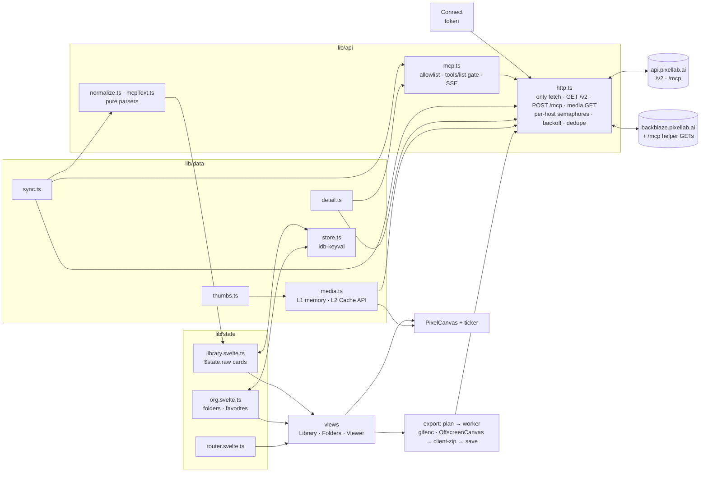

# 05 — Architecture: PixelLab Backpack (formerly Vitrine)

> **API rules: superseded by P-16** (decision log). Sync, the key test, session-mode storage and the Settings rows that call PixelLab (§5 here; 02 §3.1–3.2, §3.12) follow the [MVP plan](../plan/mvp-plan.md)'s concern 2: no balance call, a first-page check per family on open, nothing again within an hour (P-2, P-3, P-5, P-21).
>
> **Hosting: GitHub Pages (P-17).** §13.1 below describes the earlier choice.

Working name **Vitrine**, *Unofficial gallery for your PixelLab assets*. Status: architecture baseline, 2026-10-18.

**Inputs:** `00-decision-log.md` (rulings F-1 to F-16 and builder answers B-1 to B-20 override anything below; its precedence line ranks every doc and mockup, B-5), `docs/reviews/R1-research-cross-review.md` (D1–D31, S1–S16, G1–G29), `01-product-brief.md`, `02-ux-spec.md`, `07-recommended-design.md`, and research 01, 02, 06, 07 and 09.

**What this document owns:** modules, data model, network and storage contracts, the rendering, playback and download (export) engines, the router, security controls, and the test and deploy setup.

**What it does not own:** behaviour and copy (02), and layout and visuals (design 07). Where this document makes a new call, it is marked **(decision)** with a one-line reason. Everything else traces to a cited source.

**Visual direction.** The visual option is resolved: the "Quiet Studio, lifted" hybrid (design 07; F-1). It uses 02's shell, one modal viewer and 02's cell sizes (§2.3). Nothing below `src/lib/` depends on the visual design.

---

## 0. Stack check

The stack is the R1 D5 stack: Vite 8 + Svelte 5 + TypeScript ~6.0. Every point where research 07 differs from R1 or from later evidence is listed here, with the winning source.

| Topic | Research 07 said | Followed | Why |
|---|---|---|---|
| Asset ids in routes | `#/asset/character/<id>` | Opaque key `#/a/<key>` (D13) | R1 C4: UUIDs are permanent no-auth download keys |
| CSP | `default-src 'self'`, `img-src data:`, `worker-src blob:` | `default-src 'none'`, no `data:`, `worker-src 'self'` (S7). `img-src` is tightened further (§10.2) | R1 C13 |
| Bulk ZIP streaming | YAGNI, in-memory Blob | `showSaveFilePicker` streaming, else Blob with part cap (C12) | Whole-account export is a requirement |
| Default fps | — | **8 fps** (125 ms), not R1 D11's 10 fps | R1 C14 asked for a bundle check before freezing. 09 Q4 did it: PixelLab's character and Creator players and Creator GIF export use 8 fps. Brief ruling R-1 |
| Grid → viewer motion | `startViewTransition` morph | Opacity crossfade only (C11) | WebKit blur; raster snapshots |
| Desktop drag-to-folder | Native HTML DnD | Deferred; "Add to folder…" only | R1 scope check |
| PWA manifest | v1 | Phase 3, owner-gated (06 plan §5) | R1 deferred it; the brief lists "installable PWA" as a v1 non-goal |
| `pool.ts`, `Folders.svelte` | Separate files | `pool.ts` folded into `http.ts`; `Folders.svelte` is the Folders destination view (F-7) | KISS; R1 C7 |
| gifenc | npm dependency | **Vendored** source (S13) | No release since 2021; audit once |
| MCP `initialize` | Call once per load | Not called **(decision)** | The server is stateless and answers `tools/list` / `tools/call` without it (research 01, 02). If PixelLab starts requiring sessions, the unexposed `Mcp-Session-Id` is the real blocker (research 07 risk 2). |
| Invoker commands (`commandfor`) | Use for dialogs | Not used **(decision)** | Safari 26.2+ only. Dialogs open from route changes in JS anyway |

**Support floor (decision):** Safari/iOS 17.5+, Chrome/Edge 123+, Firefox 125+. This is the lowest set that has popover, `light-dark()`, 2D OffscreenCanvas in workers, and `createImageBitmap`. Anchor positioning is used only behind `@supports` (research 07 Q6).

---

## 1. How the app works

1. **Token.** The user pastes a PixelLab API key (a bearer token) on Connect; it is tested on paste with `GET /v2/balance` (F-10). The token lives only inside `api/http.ts`, mirrored to `sessionStorage` by default, or to `localStorage` with Remember (D14).
2. **Clients.** `http.ts` is the only module that calls `fetch`. It allows exactly three shapes of request: authenticated `GET /v2/*`, authenticated `POST /mcp`, and unauthenticated media GETs to allowlisted URLs. `mcp.ts` adds JSON-RPC and SSE parsing, a per-session `tools/list` annotation check, and a tool allowlist.
3. **Sync.** `sync.ts` pages every REST list at its maximum size. It also pages MCP `list_maps`, and `list_images` when the Images gate is on. Each page goes through `normalize.ts` / `mcpText.ts` into the normalized model and streams into the library store as soon as it arrives. Nothing blocks the UI (R-10).
4. **Store and cache.** `library.svelte.ts` holds every card in a `$state.raw` array. In Remember mode, snapshots and details go to IndexedDB and image bytes to the Cache API. In session mode, data stays in memory, plus the browser's HTTP cache (D15). Folders and favorites always persist, keyed by opaque asset keys.
5. **Views.** Views derive the filtered, sorted list and render it through a windowed grid. They open the viewer from a hash route and request detail lazily: on viewer open, on hover/focus play, and for capped Play previews (§5.3). Never in the background or on dwell alone (F-2).
6. **Pixels.** All art is drawn by one `PixelCanvas` component at integer device-pixel scale. One shared rAF ticker drives every player.
7. **Download (export module).** The export module plans the files, fetches them through `http.ts`, encodes GIFs, sheets and upscales in one lazy worker, zips with client-zip, and saves through the picker → Blob → share chain.



**Startup sequence:**
1. `public/theme.js` runs before first paint. It reads the theme from `localStorage` and sets `data-theme`.
2. `main.ts` mounts `App` and reads the token (`sessionStorage`, then `localStorage`). With no token, it shows Connect.
3. Remember mode: load the `lib` snapshot from IndexedDB and paint the grid at once.
4. Run `sync.start()` in the background. In session mode the grid shows skeleton cards until the first pages arrive (02 §3.2).
5. Cards in the window ask `thumbs.ts` for art: media-cost thumbnails immediately, MCP-cost thumbnails after 300 ms in view (§5.4).
6. A viewer route resolves its key from the store and calls `detail.ensure(key, 'high')`.

---

## 2. Module map

### 2.1 Folder tree

```
./                           # the project root (B-4): the app sits beside the existing docs/ and mockups/
  docs/  mockups/            # existing design record; not part of the build
  .prettierignore            # docs/, mockups/
  .github/workflows/ci.yml   # §12.5 gates; added only once a remote exists (B-4)
  index.html                 # no inline script/style; loads /theme.js then the module entry
  vite.config.ts             # svelte(); assetsInlineLimit 0; worker format 'es'; preview.headers from public/_headers
  tsconfig.json              # strict, moduleResolution bundler
  package.json, package-lock.json
  wrangler.jsonc             # assets-only deploy config (§13)
  public/
    _headers                 # CSP + security + cache headers (§13.2)
    theme.js                 # ~5 lines: localStorage theme → <html data-theme> before paint (CSP-safe, no inline)
    favicon.svg
  scripts/
    budget.mjs               # gzip budget gate (§11.4)
    guard.mjs                # CI grep guards (§12.5)
  src/
    main.ts                  # mount(App)
    App.svelte               # shell: nav, route switch, global dialogs, toasts, two live regions
    app.css                  # @layer reset, tokens (design 07 §5), base
    vendor/gifenc/           # vendored gifenc 1.0.3 + LICENSE (S13), imported only by the worker
    lib/
      app.ts                 # APP_ID (slug) + APP_NAME (display name): the only place the product name lives (B-7)
      api/
        http.ts              # token holder; the only fetch(); request guard; semaphores; retry; dedupe; error classes
        mcp.ts               # JSON-RPC over http.ts; SSE parse; tools/list gate; allowlist + arg checks
        mcpText.ts           # pure, fixture-tested parsers for MCP prose
        normalize.ts         # pure REST/MCP → model mapping, grouping, status counts, search text
        types.ts             # Asset model, Detail parts, AssetKey, Direction
      data/
        key.ts               # assetKey(ns, id) → 12-char base64url; key6()
        sync.ts              # family plans, paging, streaming apply, diff/removal, classification
        detail.ts            # ensure(key, priority, signal): parts, dedupe, cache, abort
        thumbs.ts            # per-type thumbnail loaders + alpha trim box
        media.ts             # getBlob / getBitmap: L1 LRU, L2 Cache API (Remember), decode, quota handling
        store.ts             # idb-keyval wrapper: lib snapshot, details, org; wipe()
      state/                 # module-level runes (no SSR, so no context needed; research 07 Q2)
        session.svelte.ts    # connect/test/remember/forget, mode, last4, balance, connection state
        library.svelte.ts    # cards, byKey, aliases, per-family sync status, pending counts, search/sort
        org.svelte.ts        # folders, favorites, backup export/import, orphans
        prefs.svelte.ts      # localStorage prefs + per-animation fps overrides
        router.svelte.ts     # hash router (§9)
        selection.svelte.ts  # Set<AssetKey>, anchor, mode
      render/
        fit.ts               # integerScale(), dpr rune + matchMedia watcher
        ticker.ts            # shared rAF loop + player factory (§7.3)
        PixelCanvas.svelte   # the only element that draws art (§7.1)
        gestures.ts          # pointer pinch/pan/swipe/long-press attachments
      export/
        plan.ts              # pure: (assets, preset, scope) → file jobs, ZIP paths, metadata, manifest
        formats.ts           # pure: gifDelaysCs, exactPalette, sheet layout, Aseprite JSON, slug/path checks
        run.ts               # orchestrator: fetch → worker → zip → parts → save; progress; cancel
        export.worker.ts     # upscale, sheet compose, GIF encode (gifenc), union alpha box
        save.ts              # showSaveFilePicker → Blob + <a download> → navigator.share
      ui/
        VirtualGrid.svelte   # ~40-line row windowing, list semantics, roving focus (§11.1)
        Card.svelte          # card anatomy (02 §4.5); hosts PixelCanvas; long-press; hover-play timer
        Menu.svelte          # popover menu with roving focus (research 07 Q6)
        Sheet.svelte         # <dialog> as bottom sheet / side panel
        a11y.ts              # announce(), focus helpers
    views/
      Connect.svelte  Library.svelte (also Favorites + Folder)  Folders.svelte
      Viewer.svelte (content, dock, filmstrip)  Inspector.svelte (the Info panel)  Settings.svelte
      DownloadDialog.svelte  AddToFolder.svelte  SelectionPanel.svelte  Help.svelte  (small dialogs inline in App)
  tests/
    unit/  e2e/  fixtures/   # §12
```

**Repository (B-4):** `git init` runs locally at the project root when implementation starts. There is no remote and no push until the owner chooses public or private. Before any public push, `mockups/shared/assets/` (the owner's real PixelLab art) must be removed or replaced.

**Product name (B-7):** `lib/app.ts` exports `APP_ID = 'vitrine'` and `APP_NAME = 'Vitrine'`. Every persisted or written name derives from them: the storage keys `${APP_ID}.token`, `.prefs` and `.fps`; the cache `${APP_ID}-media-v1`; the backup `app` field and file name; the sheet JSON `meta.app` (`APP_NAME`); ZIP names `${APP_ID}-{scope}-…`; page titles and UI copy. The literal `vitrine` / "Vitrine" elsewhere in this document is the current value. The wrangler `name` (§13.1) is set to the same slug by hand. The final name must be set before the first build real users touch, because a later rename makes the importer reject older backups and signs Remember-mode users out (owner decision 1). No migration or alias code.

### 2.2 Layering rules (enforced by review plus `guard.mjs`)

1. Only `lib/api/http.ts` calls `fetch`. A CI grep fails any other occurrence. This makes the view-only guard and token placement structural.
2. Only `lib/data/store.ts` and `media.ts` touch IndexedDB or the Cache API. Only `prefs.svelte.ts` and `session.svelte.ts` touch Web Storage.
3. Views never import from `lib/api`. They call state modules and `data/detail.ts` / `thumbs.ts`.
4. `normalize.ts`, `mcpText.ts`, `formats.ts`, `plan.ts`, `key.ts` and `fit.ts` are pure (no DOM, no network). They are the unit-test surface.
5. Raw PixelLab ids and media URLs exist only in the library store, the detail cache, `media.ts` cache keys and `http.ts`. Everything else handles `AssetKey`.

### 2.3 What the recommended design adds to the shell

The hybrid (design 07; F-1, F-2) needs no option-specific code paths: no grid-side inspector, no "current" asset, no dwell detail, no page route and no stage pane.

| Concern | Recommended design | Files touched |
|---|---|---|
| Shell layout | Sidebar ≥ 1200 · rail on tablet and compact height · floating pill + search bar on phone portrait (design 07 §2) | `App.svelte`, `Library.svelte`, `app.css` |
| Viewer container | One `<dialog>` at every size; Info docked, bottom sheet, or compact-height overlay | `Viewer.svelte`, `Inspector.svelte`, `Sheet.svelte` |
| Filmstrip (F-4) | Replaces the range scrubber; one consumer of the player's decoded frame bitmaps | `Viewer.svelte` |
| Selection summary panel (F-6) | Side panel at ≥ 1200 px with ≥ 2 selected; reads `selection.svelte.ts` | `SelectionPanel.svelte` |
| Cell sizes, caption height | 02 §4.1; caption height measured per level | Constants passed to `VirtualGrid` |

---

## 3. Normalized asset model

### 3.1 Asset key (D13)

```ts
// data/key.ts (illustrative)
export type KeyNs = 'character' | 'object' | 'image' | 'tileset' | 'tile-isometric' | 'tiles-pro' | 'map' | 'ui' | 'anim';
export async function assetKey(ns: KeyNs, id: string): Promise<AssetKey> {
  const d = new Uint8Array(await crypto.subtle.digest('SHA-256', new TextEncoder().encode(`${ns}:${id}`)));
  return btoa(String.fromCharCode(...d.subarray(0, 9)))      // 9 bytes = exactly 12 base64 chars, no padding
    .replaceAll('+', '-').replaceAll('/', '_') as AssetKey;
}
// key6 for file and ZIP paths: lowercase hex of the key's first 3 bytes (its first 4 base64url chars).
```

- **Namespaces are per family, not per subtype (decision).** Top-down and sidescroller tilesets share `tileset`, so a classification fix can never change a key and orphan folder entries.
- **Character cards are keyed by `group_id ?? id` (decision).** The list streams newest first, so the base state (null `state_name`, else the oldest) can arrive on a later page. Deleting a state can also change which state is the base. `group_id` is the stable identity. Every state's own `K('character', id)` is registered as an **alias** of the card key. Org lookups resolve aliases, and keys that resolve to a different card are rewritten after a complete sync. This replaces 02 §3.8's "base-state key", with the same user-visible behaviour.
- **Test vectors:**

  | Input | Key | key6 |
  |---|---|---|
  | `character:00000000-0000-4000-8000-000000000000` | `KUtzPBofv_CP` | `294b73` |
  | `object:00000000-0000-4000-8000-000000000000` | `JKZvHNFSBDjS` | `24a66f` |
  | `image:gallery:1700000000000` | `sVFlK219oKaK` | `b15165` |

- **Properties:** 72 bits, deterministic on the same account, not reversible, no mapping table. Route validation regex: `^[A-Za-z0-9_-]{12}$`.
- **Why key6 is hex, not the first six key characters (decision):** ZIP paths must stay `[a-z0-9-]` (S9), and base64url's mixed case collides on case-insensitive filesystems.

### 3.2 Interfaces

```ts
// api/types.ts
export type AssetKey = string & { readonly __brand: 'AssetKey' };
export type Direction = 'south' | 'south-west' | 'west' | 'north-west' | 'north' | 'north-east' | 'east' | 'south-east';
export type Dir = Direction | 'unknown';            // 'unknown' = 1-direction objects (research 01)
export type AssetType = 'character' | 'object' | 'image' | 'tileset-topdown' | 'tileset-sidescroller'
                      | 'tile-isometric' | 'tiles-pro' | 'map' | 'ui';
export type Chip = 'all' | 'characters' | 'objects' | 'images' | 'tilesets' | 'tiles' | 'maps' | 'ui';   // 8 chips (F-8)

interface Base {
  key: AssetKey;            // the only identifier outside the library store
  type: AssetType;
  id: string;               // raw PixelLab id (UUID or "gallery:<id>"): a capability (S4); never rendered, logged or exported
  title: string;
  w: number; h: number;     // art px for sort-by-size and pre-decode fit (see per-type notes)
  created: number | null;   // epoch ms; null for maps
  dayPrecision?: true;      // images: date only
  rev: string;              // change detector: updated_at, else preview/image URL (its ?t= stamp), else ''
  order: number;            // index in PixelLab's list order (tie-break; maps' "recently edited" order)
  text: string;             // lowercase, diacritic-stripped search haystack (02 §11.1)
}

export interface CharacterState {
  id: string; stateName: string | null; prompt: string; w: number; h: number;
  directions: 4 | 8; view: string | null; templateId: string | null;
  created: number; updated: number | null; animationCount: number; tags: string[];
  previewUrl: string | null;                         // allowlisted host, else null
}
export interface Character extends Base { type: 'character'; states: CharacterState[] }   // states[0] = base
export interface ObjectAsset extends Base {
  type: 'object'; stateName: string | null; prompt: string; directions: 1 | 4 | 8;
  view: string | null; tags: string[]; previewUrl: string | null;
}
export interface ImageAsset extends Base { type: 'image'; description: string; truncated: boolean; frames: number; madeOn: 'website' | 'api' }
export interface TilesetAsset extends Base {
  type: 'tileset-topdown' | 'tileset-sidescroller';
  lower: string; upper: string | null; transition: string | null; tileW: number; tileH: number; view: string | null;
}
export interface IsoTile extends Base { type: 'tile-isometric'; description: string; size: number; shape: string }
export interface TilesPro extends Base {
  type: 'tiles-pro'; description: string; tileType: string; tileW: number; tileH: number; nTiles: number; tileView: string | null;
}
export interface MapAsset extends Base { type: 'map'; cellsW: number; cellsH: number; terrains: number | null }
export interface UiAsset extends Base { type: 'ui'; prompt: string; imageUrl: string }
export type Asset = Character | ObjectAsset | ImageAsset | TilesetAsset | IsoTile | TilesPro | MapAsset | UiAsset;

export type Pending = Partial<Record<'characters' | 'objects' | 'ui' | 'tilesets' | 'tiles',   // tilesets/tiles only when their rows carry status (B-15)
  { generating: number; review: number; failed: number }>>;

// Lazy detail, assembled from parts (each part has its own dedupe key; §5.3)
export interface Anim { aid: AssetKey; name: string; type: string | null; description?: string; frames: Partial<Record<Dir, string[]>> }
export interface SpriteDetail {            // characters (per state) and objects
  rotations: Partial<Record<Dir, string>>; animations: Anim[];
  style: Record<string, string> | null; guidance?: number | null; aiFreedom?: number | null; hasSkeleton?: boolean;
}
export interface ImageDetail { frames: number }                 // frame bytes live in media.ts under /_m/<key>/f<i>
export interface TileInfo {
  name: string; box: { x: number; y: number; w: number; h: number };
  corners?: Partial<Record<'NW' | 'NE' | 'SW' | 'SE', string>>;
  connections?: Partial<Record<'north' | 'east' | 'south' | 'west', number>>;
}
export interface TilesetDetail {
  tiles: TileInfo[]; transition?: string; transitionSize?: number;
  style?: Record<string, string>; generation?: Record<string, number>;
}
export interface TilesProDetail {
  urls: string[]; kind: string | null;
  rules: { ruleType: string; arity: number; connectivity: string; terrains: string[]; bits: Record<string, number> } | null;
  description?: string; seed?: number;                             // MCP part
}
export interface IsoDetail { seed?: number }
export interface MapDetail {
  tile: number; terrains: string[]; painted: number;
  placements: { name: string; x: number; y: number; w: number; h: number; layer: string }[];   // no ids (02 §5.8)
}
```

`Anim.aid = K('anim', animation_group_id)`. It keys the per-animation fps override, so raw animation ids are never kept (02 §3.5).

### 3.3 Field mapping

Sources: **L** = list (sync) · **D** = REST detail · **M** = MCP call · **H** = no-auth helper GET · **X** = derived. Every URL passes `safeMediaUrl()` (§4.4); every id passes the format check, or the row is dropped and counted as a parse failure.

| Type | Model field ← source field | List vs lazy |
|---|---|---|
| **Character** (`CharactersListResponse.characters[]`, `limit` 100) | `states[].id` ← L `id` (UUID) · `stateName` ← `state_name` · `prompt` ← `prompt` · `w,h` ← `size.width/height` · `directions` ← `directions` · `view` ← `view` · `templateId` ← `template_id` · `created` ← `created_at` · `updated` ← `updated_at` · `animationCount` ← `animation_count` · `tags` ← `tags ?? []` · `previewUrl` ← `preview_url`. Card: `key` ← K(`character`, `group_id ?? id`); `title`, `w,h`, `created` ← base state; `rev` ← max `updated_at`, else the base `preview_url`. `status ≠ completed` → `Pending` | **L**: every card field. **D** (`GET /v2/characters/{id}`, per state, on demand): `rotations` ← `rotation_urls.*`; `animations` ← `animations[]` (`display_name`, `animation_type`, `animation_group_id` → `aid`, `directions[].frames[]`); `style` ← `style_settings`; `guidance`; `aiFreedom` ← `ai_freedom`; `hasSkeleton` ← `skeletons != null` (keypoints not kept: YAGNI). MCP `list_/get_character`: **not used** |
| **Object** incl. map objects (`objects[]`, `limit` 100) | `id` · `stateName` ← `state_name` · `prompt` · `w,h` ← `size` · `directions` (1/4/8) · `view` · `tags` · `previewUrl` ← `preview_url` (south, or `unknown` for 1-dir) · `created`. `key` ← K(`object`, `id`), one card per state row (C9, R-7). Status: `pending`/`processing` → generating, `review`, `failed` → `Pending` | **L**. **D** (`GET /v2/objects/{id}`): `rotations` ← `rotation_urls.*`, or `{unknown: storage_urls.unknown}` for 1-dir; `animations` ← `animations[]` (`animation_group_id`, `display_name`, `description`, `directions[].storage_urls.frames[]`); `style`. `group_id` (detail only) is unused unless P0-6 finds a list signal. `GET /v2/map-objects/{id}` and `get_map_object`: **never** (09 Q1) |
| **Image** (MCP `list_images`, `limit` 50; gated by R-4) | `id` ← row `gallery:<id>` (regex §4.2) · `description` ← row middle (`(no description)` → `''`) · `truncated` ← ends with `...` · `title` ← X first line, else "Untitled image" · `w,h` ← row `<W>x<H>` (per frame, 09 Q6) · `frames` ← row `, <k> frames`, else 1 · `created` ← row date, `dayPrecision` · `madeOn` ← X 13 digits = website, UUID = api · `key` ← K(`image`, id) · `rev` ← `''` | **L** = list row. **M** (`get_image`): frames → Blobs under `/_m/<key>/f<i>`. Only the JSON line's `frames` is read. `download_url` (presigned S3) is never read, stored or rendered (D19) |
| **Tileset, top-down** (`GET /v2/tilesets`, `limit` 100) | `id` · `title` ← `name` · `lower` ← `lower_description` · `upper` ← `upper_description` · `tileW,tileH` ← `tile_size` · `view` · `created` · `w,h` ← X 4·tile × 4·tile (the 16-tile sheet; 25-tile sets sort slightly small, accepted) · `key` ← K(`tileset`, id). `status ≠ completed` → no card; counted in `Pending.tilesets` (B-15) | **L**. **H** `/mcp/tilesets/{id}/metadata`: `transition` ← `transition_description`, `transitionSize` ← `transition_size`, `style` ← `style_settings`, `generation` ← `generation_parameters`, `tiles[]` ← `tileset_data.tiles[]` (`name`, `corners`, `bounding_box`). REST `GET /v2/tilesets/{id}` (base64 for every tile): **not used** (research 01 Impl 4) |
| **Tileset, sidescroller** (`GET /v2/tilesets-sidescroller`, `limit` 50) | `id` · `title` · `lower` ← `lower_description` · `transition` ← `transition_description` · `tileW,tileH` · `created` · `view` ← X "side" · same key namespace. `status ≠ completed` → no card; counted in `Pending.tilesets` (B-15) | **L**. **H** `/mcp/sidescroller-tilesets/{id}/metadata`: `tiles[]` with `connections` counted per side. REST get (schema `{}`): not used; P0-4 records it |
| **Isometric tile** (`GET /v2/isometric-tiles`, `limit` 100) | `id` · `title` ← `name` · `description` · `size` · `shape` ← `tile_shape` · `created` · `w,h` ← `size`. `status ≠ completed` → no card; counted in `Pending.tiles` (B-15) | **L**. **M** `get_isometric_tile`: `seed`. REST get (base64 only): not used |
| **Tiles Pro** (`GET /v2/tiles-pro`, `limit` 50) | `id` · `title` · `description` · `tileType` ← `tile_type` · `tileW,tileH` ← `tile_size` · `nTiles` ← `n_tiles` · `tileView` ← `tile_view` · `created` · `w,h` ← X ⌈√n⌉-column grid. `status ≠ completed` → no card; counted in `Pending.tiles` (B-15) | **L**. **D** `GET /v2/tiles-pro/{id}`: `urls` ← `storage_urls.tile_N` sorted by N; `kind`; `rules` ← `tile_rules`. **M** `get_tiles_pro`: full `description`, `seed` |
| **Map** (MCP `list_maps`, `limit` 100) | `id` ← row UUID · `title` ← row name · `cellsW,cellsH` ← `<W>x<H> cells` · `terrains` ← `<k> terrains` · `created` ← null · `order` ← row index · `w,h` ← X cells × 16 until `get_map` gives the tile size · `key` ← K(`map`, id) | **L**. **M** `view_map` = thumbnail and stage image. **M** `get_map`: `tile`, `terrains` (legend), `painted`. **M** `list_map_objects`: `placements` (name, `stands_on`, `size_cells`, layer; `placement_id`/`asset_id` dropped inside the parser) |
| **UI** (`GET /v2/ui-assets`, `limit` 100) | `id` · `title` ← `name` · `prompt` · `w,h` ← `size` · `created` · `imageUrl` ← `image_url` · `rev` ← `image_url`. Ghost rows (`status ≠ completed` or `image_url` null) → `Pending.ui.generating` | **L** only. The REST get adds only progress fields: not used |

**Not modelled** (no public list path; R-5, 09 Q8): fonts, effects, portraits, talking animations, uploads, projects. The "not in the public API yet" note (end of All, Settings › About; F-8) is static UI.

### 3.4 Pure derivations

| Function | Rule | Source |
|---|---|---|
| `groupCharacters(rows)` | Key by `group_id ?? id`. Base = `state_name` null, else oldest `created`. Other states sort by `created` ascending. Card exists only if ≥ 1 state is completed; non-completed states are counted, not shown | G14, C10 |
| `classifyTileset(id)` | In the sidescroller list → sidescroller, else top-down. De-duplicate by id across both lists | C22, P0-5 |
| `pendingCounts(rows)` | Per family whose list rows carry `status` (characters, objects, UI; tilesets and tiles per B-15): `review` → review, `failed` → failed, any other non-`completed` value or a UI ghost row → generating. A family whose rows lack `status` (P0-4 checks) is left out of the counts | C10, B-15 |
| `searchText(asset)` | Fields from 02 §11.1, `NFKD`, diacritics stripped, lowercased, joined with `\n`. Tags kept separately for `#tag` exact matching | 02 §11 |

---

## 4. API layer

### 4.1 `http.ts`: the one network module

**Exported surface (nothing else can reach the network):**

| Function | Method + URL | Auth | Used for |
|---|---|---|---|
| `apiGet(path, {as:'json'\|'blob', priority, signal})` | `GET https://api.pixellab.ai` + path. Path must match one of: `/v2/balance`, `/v2/(characters\|objects\|tilesets\|tilesets-sidescroller\|isometric-tiles\|tiles-pro\|ui-assets)` with only `limit`/`offset` params, `/v2/(characters\|objects\|tiles-pro)/{uuid}`, `/v2/objects/{uuid}/spritesheet` | Bearer | Lists, details, balance, object sheet (D18) |
| `mcpPost(body, {priority, signal})` | `POST https://api.pixellab.ai/mcp` (exact) | Bearer | `mcp.ts` only |
| `publicGet(url, {as, priority, signal})` | `GET`. URL must be `https://backblaze.pixellab.ai/…`, or `https://api.pixellab.ai` + one of `/mcp/(tilesets\|sidescroller-tilesets)/{uuid}/(image\|metadata)`, `/mcp/isometric-tile/{uuid}/download`, `/mcp/tiles-pro/{uuid}/download`, `/v2/characters/{uuid}/(zip\|spritesheet)` | **None.** No headers at all, `credentials:'omit'`, so these stay simple requests with no preflight (R1 weak-claims row) | Thumbnails, frames, helper metadata, official no-auth exports |
| `setToken(t\|null)`, `onAuthLost(cb)`, `onStatus(cb)` | — | — | `session.svelte.ts` |

**The single internal `send()` re-checks every request (defense in depth, S2/S3):**

```ts
// illustrative — the only fetch() in src/
function send(method: 'GET' | 'POST', u: URL, auth: boolean, init: RequestInit) {
  const api = u.origin === 'https://api.pixellab.ai';
  const ok = u.protocol === 'https:' && !u.username && !u.password && (
    (method === 'GET'  && api && u.pathname.startsWith('/v2/')) ||
    (method === 'POST' && api && u.pathname === '/mcp' && auth) ||
    (method === 'GET'  && !auth && (u.host === 'backblaze.pixellab.ai' || (api && HELPER.test(u.pathname)))));
  if (!ok) throw new ViewOnlyError(method, u.pathname);  // no network call happens
  if (auth && !(api && (u.pathname.startsWith('/v2/') || u.pathname === '/mcp'))) throw new ViewOnlyError(method, u.pathname);
  const headers = auth ? { ...init.headers, Authorization: `Bearer ${token}` } : undefined;  // media: no headers
  return fetch(u, { ...init, method, headers, credentials: 'omit', referrerPolicy: 'no-referrer', signal: init.signal });
}
```

**Per-host semaphores (D25):**

| Lane | Hosts | Default permits | Notes |
|---|---|---|---|
| `api` | `api.pixellab.ai`: REST, MCP and helper GETs | 4, dropping to 2 for the rest of the session after any 429 | P0-8 (with A3) sets the final number; 2 until its result lands (B-1) |
| `media` | `backblaze.pixellab.ai` | 8 | Cloudflare-cached, immutable |
| `render` | nested inside `api` for `view_map` only | 1 | Four-figure map counts; P0-10 measures the cost |

Each semaphore has two priority queues. **high** = user-initiated (viewer detail, hover/focus play detail, Connect, download). **low** = sync pages, thumbnails, and Play previews detail, which also passes a 1-permit preview gate so only one preview detail fetch is in flight (F-9). A queued job whose `signal` aborts is dropped before it starts.

**Retry and status policy:**

| Outcome | Action |
|---|---|
| 2xx | Parse as requested |
| 401 (REST), or MCP `isError` text containing `401` | `authLost()`: clear the token everywhere (S2), abort the session `AbortController` (every in-flight and queued request), emit `auth-lost`. No retry |
| 423 | `GeneratingError`; no retry (the item counts as generating) |
| 404, 410 | `GoneError`; no retry (asset removed on the next complete sweep; viewer shows the standard error) |
| 429, 5xx, 529, network `TypeError` while online | Full-jitter backoff: `delay = random(0, min(30 s, 1 s · 2^attempt))`, max 5 attempts. `Retry-After` is unreadable (not exposed). After 2 consecutive 429s emit `rate-limited` (02 §8) |
| `TypeError` while `navigator.onLine` on the first request of a session | Probe `fetch(sameUrl, {mode:'no-cors'})`. Opaque success → `CorsBlockedError` (02 §3.1). Failure → `NetworkError` |
| Other 4xx | No retry; typed error carrying the status only |
| `AbortError` | Propagate silently |

**Dedupe with refcounted abort:** in-flight `Map<string, {promise, controller, refs}>`, keyed by `method + url` (GET) or `'mcp' + method + JSON(params)` (MCP, before the JSON-RPC id is assigned). Each caller's `signal` decrements `refs`. The shared request aborts only when `refs` reaches 0. This is what lets `view_map` really cancel when a card scrolls away.

**Errors are data-free (S10):** error objects carry the type, status and asset key. They never carry the URL, the response text or the token. Production code never calls `console.log`; a CI grep enforces this.

### 4.2 `mcp.ts`: ~40-line client

```ts
// illustrative
const ALLOW = {                       // S3 + 02 §5.8; nothing else is ever sent
  list_images: 'ro', get_image: 'gallery', list_maps: 'ro', view_map: 'ro',
  get_map: 'ro', list_map_objects: 'ro', get_isometric_tile: 'ro', get_tiles_pro: 'ro',
} as const;
const GALLERY_REF = /^gallery:(\d{13}|[0-9a-f-]{36})$/;   // R1 C3
let seq = 0, gate: Promise<Set<string>> | null = null;

async function rpc(method: string, params: object, o: Opts) {
  const id = ++seq;
  const { type, text } = await mcpPost(JSON.stringify({ jsonrpc: '2.0', id, method, params }), o);
  const msgs = type.includes('text/event-stream')
    ? text.split(/\r?\n\r?\n/).map(ev => ev.split(/\r?\n/).filter(l => l.startsWith('data:'))
        .map(l => l.slice(5).trimStart()).join('\n')).filter(Boolean).map(safeJson).filter(Boolean)
    : [safeJson(text)];
  const msg = msgs.find(m => m?.id === id);
  if (!msg) throw new McpProtocolError();
  if (msg.error) throw new McpProtocolError(msg.error.code);
  return msg.result;
}
function enabled(): Promise<Set<string>> {           // once per token; authenticated tools/list (P0-2)
  return (gate ??= rpc('tools/list', {}, { priority: 'high' }).then(({ tools }) => new Set(
    tools.filter((t: Tool) => ALLOW[t.name as keyof typeof ALLOW] === 'ro'
        ? t.annotations?.readOnlyHint === true
        : ALLOW[t.name as keyof typeof ALLOW] === 'gallery' && IMAGES_ENABLED
          && t.annotations?.destructiveHint === false).map((t: Tool) => t.name))));
}
export async function callTool(name: keyof typeof ALLOW, args: Record<string, unknown>, o: Opts) {
  if (!(name in ALLOW) || !checkArgs(name, args)) throw new ViewOnlyError('mcp', name);       // before any network
  if (name === 'get_image' && !GALLERY_REF.test(String(args.job_id))) throw new ViewOnlyError('mcp', name);
  if (!(await enabled()).has(name)) throw new ToolDisabledError(name);
  const r = await rpc('tools/call', { name, arguments: args }, o);
  if (r.isError) throw toolError(r.content);                     // "401" → AuthError; else generic, text discarded
  return r.content as McpContent[];                               // [{type:'text',text} | {type:'image',data,mimeType}]
}
```

- `checkArgs` allows only the documented keys and types (09 Q2): `limit`/`offset` integers, `search` absent, `map_id`/`tile_id` UUIDs, `index` integer ≥ 0, crop params absent.
- `IMAGES_ENABLED` is a build-time flag (`VITE_IMAGES`). It is `true` only if P0-9 (`get_image` side effects, run under owner approval A1) passes and P0-14 shows no spend (R-4, B-3). It is `false` until those results land (B-1).
- `tools/list` pagination (`nextCursor`) is not followed. A tool missing from page 1 is treated as disabled, which fails safe.
- `get_map_object` and `list_projects` are not in `ALLOW`, so the client cannot call them (S6, 09 Q1). The secret-bearing git URL can never enter the app.

### 4.3 Parsing MCP's LLM-oriented text

| Tool | Structured part | Text parsing | Fail-soft rule |
|---|---|---|---|
| `tools/list` | JSON `result.tools[]` | — | Tool missing or re-annotated → feature off, with family error `tools` ("{Maps} couldn't be loaded") |
| `list_images` | none | Header `/gallery images: (\d+) total/`. Rows: `IMAGE_ROW` below, anchored at both ends with a greedy middle, so descriptions containing ` \| ` survive | Unmatched rows are counted. If the page has `total > 0` and zero rows parsed → family error `format`, stop paging. Optional groups missing → defaults |
| `get_image` | One text block that is JSON (`asset_id`, `frames`, `download_url`) plus one `image` block per frame | `JSON.parse` of the first text block starting with `{`. Only `frames` is read | No JSON → `frames` = number of image blocks. A non-`image/png` block is rejected. Frames past the inline set are fetched with `index` |
| `list_maps` | none | Header `/(\d+) of (\d+) maps/`. Rows: `MAP_ROW` below | As `list_images` |
| `view_map` | `image` block | — | No image block → thumbnail failed state (02 §4.6) |
| `get_map` | none | `key: value` lines: `tile size: (\d+)px`, `painted cells: (\d+)`, legend `x=name` pairs split on `\|` | Missing field → inspector row hidden (02 §5) |
| `list_map_objects` | none | Table rows after the header line. Columns split on runs of ≥ 2 spaces. `placement_id`/`asset_id` are dropped inside the parser | Row mismatch → "Placed objects" row hidden |
| `get_isometric_tile` | `image` block (ignored) | `/^seed:\s*(\d+)/m` | Hidden |
| `get_tiles_pro` | none | `/^description:\s*(.+)$/m`, `/^seed:\s*(\d+)/m` | Hidden; the list description stays |

```ts
// mcpText.ts row patterns (formats recorded in research 01 and 09; re-frozen by P0-11)
const IMAGE_ROW = /^\s*(gallery:\S+)\s+\|\s(.*)\s\|\s(\d+)x(\d+)(?:, (\d+) frames?)?\s\|\s(\d{4}-\d{2}-\d{2})\s*$/;
const MAP_ROW   = /^\s*([0-9a-f-]{36})\s+(.*?)\s+(\d+)x(\d+) cells(?:, (\d+) terrains?)?\s*$/;
```

Rules for every parser:
1. Before matching, drop any line containing a URL with userinfo (`/:\/\/[^\s/]*@/`) or the text `git clone`. This is defense in depth; no allowlisted tool emits them.
2. Raw MCP text is never stored, rendered or logged. Only extracted fields leave `mcpText.ts`.
3. Each parser returns `{ value, unparsed: number }`. `unparsed > 0` increments a per-family counter shown in the sync popover ("3 items couldn't be read").
4. Fixtures are shape-faithful synthetic text in the formats recorded by research 01 and 09, re-frozen from P0-11 with every value replaced by a placeholder. Upgrade path: if PixelLab ever adds `structuredContent`, read it first and keep the text parser as fallback (`// ponytail:` note in code).

### 4.4 Host allowlist for media and links (S8)

`safeMediaUrl(s)`:
1. `new URL(s)` must succeed.
2. `protocol === 'https:'`, no `username`/`password`.
3. `host === 'backblaze.pixellab.ai'`.
4. Otherwise → `null`, and the field is treated as missing.

This rejects `javascript:`, `data:`, foreign hosts, and the dead documentation hosts (`supabase.pixellab.ai`, `cdn.pixellab.ai`; 09 Q3).

If P0-3 finds another live host, it is added in exactly three places: `safeMediaUrl`, the `send()` media branch, and CSP `connect-src`.

**Helper and hand-off URLs are built, never taken from data:** `base + fixedTemplate + uuid`, with the id validated against the UUID regex. Website base: `https://www.pixellab.ai` (research 03) for every PixelLab website link, the account page included (B-8). Hand-off routes come from 02 §3.11 as kept by P0-12; until its result lands, every type uses its library page (B-1).

---

## 5. Sync engine

### 5.1 Initial sync

| # | Source | Page size | Lane | Starts after |
|---|---|---|---|---|
| 1 | `GET /v2/characters` | 100 | api | — |
| 2 | `GET /v2/objects` | 100 | api | — |
| 3 | `GET /v2/ui-assets` | 100 | api | — |
| 4a | `GET /v2/tilesets-sidescroller` | 50 | api | — |
| 4b | `GET /v2/tilesets` | 100 | api | 4a complete **(decision: classification is final when top-down rows arrive; no flicker)** |
| 5 | `GET /v2/isometric-tiles` | 100 | api | — |
| 6 | `GET /v2/tiles-pro` | 50 | api | — |
| 7 | MCP `list_maps` | 100 | api | `tools/list` gate |
| 8 | MCP `list_images` | 50 | api | gate, and `IMAGES_ENABLED` |

Procedure:
1. Enqueue page 0 of every source in the table order at **low** priority. The `api` semaphore admits 4 at a time.
2. On each page-0 response, read `total` (REST `total`, MCP header). Enqueue the remaining offsets for that source.
3. Each page is normalized off the reactive path and pushed into a buffer. `library.flush()` runs at most every 200 ms or once per rAF. It merges by key into `Map<AssetKey, Asset>`, rebuilds aliases and the `$state.raw` array, and recomputes `Pending`.
4. **Scroll anchoring:** before a flush that inserts above the viewport, `VirtualGrid` records the first visible key and its offset. After the flush it restores that offset via `scrollTo`. At the top of the list, nothing is anchored (02 §3.2.3).
5. **Progress:** `library.sync` = `{ [family]: { state: 'idle'|'running'|'done'|'error'|'off', loaded, total|null, error?: 'network'|'format'|'rate'|'auth'|'tools'|'gate' } }`. The status line sums `loaded / Σtotal`. `a11y.announce` fires at start, at 50 % and at the end (02 §10.3).
6. **A family is complete** when every page succeeded. Only complete families take part in removal and orphan checks.

### 5.2 Incremental refresh

PixelLab lists have no `since`, sort or ETag (research 01, 02 §2.2), so a refresh re-lists everything. That is 10–30 requests for a typical account.

| Step | Rule |
|---|---|
| Triggers | App open, Sync now, reconnect, and tab visible again after > 15 min (02 §3.2.8). No polling |
| Merge | Same as the initial sync. Remember mode paints the snapshot first ("Checking for new assets…") |
| Removal | After a family completes, keys in the store but not in the sweep are deleted, along with their details. Media entries are left alone (cleared by "Clear saved images" or Forget) |
| Change detection | `rev` differs from the stored record → drop that key's cached detail. Thumbnails are cached by URL including `?t=`, so new bytes arrive by themselves |
| Images and maps | No version stamp (P0-9 records whether bytes change under the same id). The viewer ⋯ "Reload from PixelLab" deletes `/_m/<key>/*` and that key's detail, then re-fetches (02 §4.7) |
| Snapshot write | Remember mode: `store.saveLib(cards)` after each family completes (throttled to 1 per 2 s) |

### 5.3 Lazy detail policy

`detail.ensure(key, priority, signal)` returns the parts the viewer needs for that type. Each part has its own dedupe key and cache entry.

| Trigger | Priority | Parts | Cancel when |
|---|---|---|---|
| Viewer open, or prev/next | high | All parts for the type, for the current state | Viewer closes or moves on (refcount reaches 0) |
| Fine-pointer hover/focus dwell 300 ms on an animated card (02 §4.8) | high | Character/object `rest` part; image frames | Pointer leaves, blur |
| Play previews on (default; F-9): in-view animated cards, at most 8 playing, nearest the viewport centre first; off at start under reduced motion or Save-Data unless explicitly on | low, through the 1-permit preview gate (one fetch at a time) | Same as hover | Card leaves the window |
| Tiles Pro thumbnail | low | `rest` part only (`storage_urls`) | Card unmounts |
| Download | high, sequential inside the download | Parts needed by the plan | Download cancel |

**Never:** background prefetch of all details, neighbour prefetch, dwell prefetch of a "current" asset (F-2), or a detail fetch done only to group cards (R1 scope check, C9).

**Preview default flag:** `PREVIEWS_DEFAULT_ON` (build constant, default `true`) is set to `false` if Phase 0 P0-14 shows any read cost or P0-8 hits a 429 at concurrency ≤ 2 (06 §2.3; F-9, E-9). It holds that failed default, `false`, until the results land (B-1). The user's explicit choice in `prefs` always wins.

| Type | Parts → calls |
|---|---|
| Character (per state) | `rest` → `GET /v2/characters/{stateId}` |
| Object | `rest` → `GET /v2/objects/{id}` |
| Image | `frames` → `get_image({job_id})` for the inline frames, then `get_image({job_id, index})` for each missing frame, sequential |
| Top-down / sidescroller tileset | `meta` → H `…/metadata` |
| Isometric | `mcp` → `get_isometric_tile` |
| Tiles Pro | `rest` → `GET /v2/tiles-pro/{id}`; `mcp` → `get_tiles_pro` |
| Map | `map` → `get_map`; `placements` → `list_map_objects` (paged, `limit` 200) |
| UI | none |

**Detail cache:**
- Memory: LRU of 300 entries.
- Remember mode: also IndexedDB `detail:<key>:<part>`.
- Session mode: memory only.

### 5.4 Thumbnail acquisition (`thumbs.ts`)

| Type | Loader | Lane | When | Cache key |
|---|---|---|---|---|
| Character | `publicGet(base.previewUrl)` | media | Card mounted (visible + overscan) | URL |
| Object | `publicGet(previewUrl)` | media | same | URL |
| UI | `publicGet(imageUrl)` | media | same | URL |
| Top-down tileset | `publicGet(api + /mcp/tilesets/{id}/image?inline=true)` | api | same | URL |
| Sidescroller tileset | `publicGet(api + /mcp/sidescroller-tilesets/{id}/image)` (302 → backblaze) | api | same | URL |
| Isometric | `publicGet(api + /mcp/isometric-tile/{id}/download)` | api | same | URL |
| Tiles Pro | `detail.rest` → `publicGet(urls[0..3])` → 2×2 block drawn into one canvas (1 tile if n < 4) | api + media | **Visible** ≥ 300 ms | each tile URL |
| Image | `callTool('get_image', {job_id, index: 0})` | api | **Visible** ≥ 300 ms | `/_m/<key>/f0` |
| Map | `callTool('view_map', {map_id})` | api + render (1) | **Visible** ≥ 300 ms; aborted when the card unmounts | `/_m/<key>/map` |

- **Mechanism:** `VirtualGrid` mounts only windowed cards and passes `visible` (in viewport) vs overscan. A card starts media-cost loads on mount and MCP/detail-cost loads after a 300 ms `visible` dwell. Unmounting aborts the load. Until art arrives the card shows its placeholder title (02 §4.6, R-6).
- **Trim (G13):** characters and objects only. After decoding, `alphaBox(imageData)` finds the opaque bounding box (alpha > 0) on a ≤ 256 px source. The scan runs on the main thread in under 1 ms (`// ponytail:` move to the worker if a trace shows > 2 ms tasks). The box is memoized in memory by cache key; it is cheaper to recompute than to persist. Hover/in-view play uses the **union** box of the frames being played (research 06), bottom-aligned. A one-step k change at play start is accepted; revisit in Phase 1 if it looks jumpy.

### 5.5 `media.ts`

```
getBlob(cacheKey, load, {priority, signal}) → Blob
  L1  memory LRU by bytes (32 MB coarse / 96 MB fine)
  L2  Remember only: caches.open('vitrine-media-v1').match(cacheKey)
  net load(signal) → Blob; store L1; Remember: cache.put(cacheKey, new Response(blob, {headers:{'content-type': blob.type}}))
getBitmap(cacheKey, load, opts) → ImageBitmap     viewer/hover frames; LRU by w·h·4 bytes (64 MB coarse / 256 MB fine); close() on evict
```

- **Inline media** (MCP frames, map renders) use cache keys `${location.origin}/_m/<assetKey>/<slot>`. These same-origin paths are never fetched from the network. One store, one wipe, one "Clear saved images".
- **Re-wrapping:** blobs are always stored re-wrapped in a fresh `Response`, never as the fetched one. This sidesteps redirected-response edge cases.
- **Quota:** a `QuotaExceededError` on `put` → `caches.delete('vitrine-media-v1')` and the storage-full toast. Org data is never touched (02 §8).
- **Session mode** has no L2. URL media re-fetches come from the browser HTTP cache (`max-age=31536000`). Inline media evicted from L1 costs one MCP read to re-fetch.
- No pruning of orphaned cache entries (`// ponytail:` add a sweep over `cache.keys()` at sync end if storage complaints appear).

### 5.6 Persistence by mode (D15)

| Data | Session mode ("This tab only") | Remember mode ("Keep me signed in") | Forget | 401 mid-session |
|---|---|---|---|---|
| Token | `http.ts` memory + `sessionStorage['vitrine.token']` | memory + `localStorage['vitrine.token']` | cleared everywhere | cleared everywhere (S2) |
| Library cards | memory | + IndexedDB `lib` = `{v:1, syncedAt, cards}` | deleted | kept **(02 §8 decision)** |
| Details | memory LRU | + IndexedDB `detail:<key>:<part>` | deleted | kept |
| Media | L1 + browser HTTP cache | + Cache API `vitrine-media-v1` | `caches.delete`; copy notes the HTTP cache (S5) | kept |
| Org (folders, favorites) | IndexedDB `org` | same | kept unless "Also delete my folders and favorites" is ticked | kept |
| Prefs, fps overrides, export choices, `lastMode`, backup-tip date | `localStorage['vitrine.prefs']`, `['vitrine.fps']` | same | kept (no capabilities) | kept |

- **Session → Remember:** write the current cards and cached details; persist media from now on (L1 blobs are copied into L2).
- **Remember → Session** (after the confirm): the token moves to `sessionStorage`, `lib` and `detail:*` are deleted, and `caches.delete` runs immediately (02 §3.12).
- **Forget** = abort the session controller, cancel any export, terminate the worker, clear L1 and bitmaps, then the table above.

---

## 6. Local organization store

### 6.1 Schema (IndexedDB key `org`; also the backup file)

```ts
interface OrgV1 {
  app: 'vitrine'; version: 1; exportedAt?: string;      // exportedAt only in backup files
  folders: { id: string; name: string; createdAt: string; items: AssetKey[] }[];   // id = crypto.randomUUID() (local, not a PixelLab id)
  favorites: AssetKey[];
}
```

- **In memory:** `$state` (small; deep proxy is fine), persisted on every change with a 300 ms debounce.
- **Folder rules:** `items` is in insertion order and the last item is the cover. Names are trimmed, 1–60 characters, and unique case-insensitively. Folders are displayed A–Z (02 §3.8).
- **Resolving keys:** all reads go through `library.resolve(key)` = `byKey.has(key) ? key : aliases.get(key)`.

### 6.2 Backup export / import (02 §3.12)

| Step | Rule |
|---|---|
| Export ("Download backup") | `JSON.stringify(org + exportedAt)` → Blob → `save.ts` as `vitrine-backup-YYYY-MM-DD.json`. Opaque keys only (S4) |
| Validate | ≤ 5 MB. `JSON.parse`. `app === 'vitrine'`. `version === 1` (higher → "made by a newer version"). Arrays present. Keys match `^[A-Za-z0-9_-]{12}$`. Names are 1–60-character strings. Invalid entries are dropped and counted; an invalid file → "That file isn't a Vitrine backup." |
| Merge folders | Match by name, case-insensitive. Match → union items (existing order kept, new items appended). No match → new folder with a **new** local id |
| Merge favorites | Union |
| Never delete | Import only adds |
| Alias migration | Imported keys that resolve to a different card key are rewritten to the card key |
| Report (S23) | Folders imported/merged, favorites added, orphans. Before a complete sync: "Items will be checked after your library finishes syncing" |

### 6.3 Orphans ("no longer in your library")

- **Computed only after every enabled family has completed in this session.** Keys are opaque, so their family can't be known, and checking against a partial library would produce false orphans.
- **Orphan** = `resolve(key)` is undefined.
- Folder and Favorites views show "{n} items … aren't in your PixelLab library anymore. [Remove them]". Removal is explicit only; nothing is auto-deleted.

---

## 7. Rendering and playback

### 7.1 Integer device-pixel scaling (D8, research 06 R1–R4)

```ts
// render/fit.ts — port of mockups/shared/pixel-utils.js integerScale (same epsilon and tests)
export function integerScale(artW: number, artH: number, boxW: number, boxH: number, dpr = dprState.value) {
  if (!(artW > 0 && artH > 0)) return null;
  const fit = Math.min(Math.floor(boxW * dpr + 1e-6) / artW, Math.floor(boxH * dpr + 1e-6) / artH);
  const k = fit >= 1 ? Math.floor(fit) : fit;
  return { k, smooth: fit < 1, cssW: (artW * k) / dpr, cssH: (artH * k) / dpr };
}
// dprState = $state({ value: devicePixelRatio }), updated by a self-re-arming
// matchMedia(`(resolution: ${devicePixelRatio}dppx)`) 'change' listener (MDN pattern, research 06 R3).
```

**`PixelCanvas` is the only element that draws art (decision).** It covers thumbnails, card previews, the viewer stage and folder covers. The reasons:
- One code path for crispness.
- The trim scan needs pixel access anyway.
- No `blob:` URL lifecycle.
- Bounded memory for oversized art.
- Hover-play reuses the same element.

Research 06's `` for static thumbnails is replaced; art stays `alt=""` inside named links, so semantics don't change.

| Case | Backing store | CSS size | `image-rendering` | Smoothing |
|---|---|---|---|---|
| k ≥ 1 | Source rect (trimmed box, frame or sheet) at 1:1 | `cssW × cssH` via `canvas.style.width/height` (CSSOM, CSP-safe) | `pixelated` | `imageSmoothingEnabled = false`, re-set after every resize (research 06 R4) |
| k < 1 (maps, big images, big sheets) | Device-pixel box `round(cssW·dpr) × round(cssH·dpr)` | `cssW × cssH` | `auto` + "fit" marker | on (`imageSmoothingQuality = 'high'`) |

- **Banned on art and its ancestors:** `transform`, `zoom`, `object-fit`, `background-image` (Safari bugs 185683, 177037, 289023). Positioning uses layout only (`top`/`left`/margins).
- **Re-fit triggers:** DPR change, `ResizeObserver` on the art box, source change.
- **On destroy:** `canvas.width = canvas.height = 0`, which releases iOS canvas memory immediately.
- **Viewer zoom (02 §6.3):**
  - Steps are CSS multiples m ∈ {1, 2, 3, 4, 6, 8, 12, 16}, rendered as `k = max(1, round(m · dpr))`.
  - Fit = largest integer k that fits the stage, or the k < 1 row above.
  - Pan moves the canvas with `left`/`top` in whole device pixels (`Math.round(x·dpr)/dpr`).
  - The map viewer instead redraws the visible source rectangle into a viewport-sized canvas (research 06 map viewer).

### 7.2 Shared ticker (research 06 Engine)

- One module-level rAF loop, running only while ≥ 1 player is playing.
- `dt = min(now − last, 250)`.
- Every player pauses on `visibilitychange` → hidden and resumes its own prior state on visible.
- Players redraw only when the frame index changes.

### 7.3 Player state machine

Inputs: `durations: number[]` (ms), `draw(i)`, `loop: boolean`, frame sources per direction.

| State | Event | Next | Effect |
|---|---|---|---|
| `loading` | current direction's frames decoded | `paused`, or `playing` if `wantPlay` | Play button shows "Loading frames i/n" while loading (02 §3.5.2) |
| `paused` | `play` | `playing` | Register with the ticker |
| `playing` | `pause` | `paused` | Unregister |
| `playing` | tick reaches the last frame, `loop = false` | `ended` | Stays on the last frame |
| `ended` | `play` | `playing` from frame 0 | — |
| any ready | `step(±1)` | `paused` | `i = (i ± 1 + n) % n`; draw |
| any ready | `seek(i)` (filmstrip frame) | `paused` | draw |
| any | `setFps(f)` | same | `durations.fill(1000 / f)`; persist `prefs.fps[aid] = f`; "Reset" deletes it |
| any | `setLoop(b)` | same (`ended` → `paused` if b) | — |
| any | `setDirection(d)` | `loading` if not decoded, else same | Keep `i` clamped to the new length; keep `wantPlay` |
| any | `setAnimation(a)` | `loading`/same | `i = 0`; keep play/pause |
| any | `setState(s)` | `loading` | Keep direction. Keep the animation if one with the same `type` exists, else Rotations (02 §3.5.5) |
| any | select **Rotations** | `static` | Transport hidden; draw the rotation for the direction |

- **Initial values:** autoplay (`wantPlay = true`), except under `prefers-reduced-motion`, which opens `paused`. On prev/next the viewer passes the previous animation type and direction; the player keeps them when the new asset has them (F-14).
- **Timing:** effective fps = `prefs.fps[aid] ?? 8` (R-1, 09 Q4). Frame sources come from `media.getBitmap`.
- **Decode order:** only the current animation × direction is decoded. Other directions decode when selected (an 8-dir character with 10 animations is about 720 frames; research 06 memory).
- **Filmstrip (F-4):** draws the current animation × direction's decoded bitmaps into small `PixelCanvas` cells (integer-fit), virtualized beyond 40 frames; a cell click calls `seek(i)`. It adds no fetches.
- **Not built:** ping-pong, all-directions lockstep.

---

## 8. Download (export) pipeline

The user-facing word is "Download" (F-5); the module keeps the technical name `export/`.

### 8.1 Flow

```
DownloadDialog / Download menu → plan.ts (pure) → run.ts
  for each asset (sequential):  fetch sources (publicGet/apiGet/media cache, lane semaphores)
                                → worker ops (upscale | sheet | gif | trim) as needed
                                → yield ZIP entries { name, input: Blob, lastModified }
  → client-zip downloadZip(asyncIterable) → save chain
  → manifest.json yielded last (errors complete)
```

- `client-zip` and `run.ts` form one lazy chunk. The worker is a second lazy chunk, created on the first export and kept for the session.
- **One export at a time** (02 §7.7.5). A second request shows the busy copy.
- **Lookahead:** the iterator keeps up to 8 source fetches in flight ahead of the ZIP writer, bounded to 32 MB of pending bytes.
- **Cancel:** aborts the export's controller (fetches), sends the worker an `abort` op, and aborts the writable stream or discards the Blob parts.

### 8.2 Worker protocol (one request/response pair; no Comlink, research 07 Q10)

`postMessage({ id, op, ... })` → `{ id, ok: true, blob | box } | { id, ok: false, reason }`. Inputs are Blobs (cheap structured clone). The worker decodes with `createImageBitmap(blob)`, draws on `OffscreenCanvas`, and returns `convertToBlob({type:'image/png'})` or the GIF bytes.

| Op | Input | Algorithm |
|---|---|---|
| `upscale` | Blob, n ∈ {2, 4, 8} | Canvas `w·n × h·n`, smoothing off, one `drawImage` |
| `sheet` | frames[] (Blob + row, col), cell, spacing, n | §8.3 |
| `gif` | frames[] (Blobs), durations, options | §8.4 |
| `trim` | frames[] | Union alpha box (shared `alphaBox` from `formats.ts`) |

### 8.3 Per-format algorithms (D17, 02 §7)

| Format | Algorithm |
|---|---|
| **PNG 1×** | Source bytes passed through: the fetched Blob, or the decoded inline base64. Never touches a canvas (research 06 R7). Unit test: byte-identical |
| **PNG N×** | Worker `upscale`. Disabled when `w·n · h·n > CANVAS_CAP` (16,777,216 px on coarse pointers, 67,108,864 px otherwise; tuning values), with "Too large for this device at {n}×" |
| **Sprite sheet** | Rows: row 0 = rotations, in API order (`south, west, east, north, south-east, north-east, north-west, south-west`, present ones only). Then for each animation (API order) × each direction (same order) with frames: one row. Columns = max frames. Cell = max frame w × max frame h. Frame offset `floor((cell − size)/2)`. No spacing between cells, no outer border, no power-of-two padding. Scopes: *this animation* (its direction rows) and *everything* (rotations + all animations; the menu default). Multi-frame image → one row. Tiles Pro → ⌈√n⌉ columns. Then scale n. The PNG and its JSON always ship together in one ZIP (02 §7) |
| **Aseprite-hash JSON** | `frames`: keys `{slug}_{anim}_{dir}_{iii}`, inserted in row-major order, each `{frame:{x,y,w,h} (cell × n), rotated:false, trimmed:false, spriteSourceSize:{x:0,y:0,w,h}, sourceSize:{w,h}, duration: ms}`. `meta`: `{app:"Vitrine", version, image, format:"RGBA8888", size, scale:String(n), frameTags:[{name:"{anim}_{dir}", from, to, direction:"forward"}]}`. `animations`: `{ "{anim}_{dir}": [frame keys] }`. Rotations: tags `rotation_{dir}`, one frame each. No engine-compatibility claims (R1) |
| **GIF** | 1. Frames of one animation × direction, timed at the current playback speed. 2. Crop to the union alpha box (always on; 02 §7.3). 3. Scale: Auto = smallest n ∈ {1, 2, 4, 8} with longest side ≥ 256. 4. Semi-alpha: default *threshold* (alpha ≥ 128 → opaque, else transparent). *Matte*: composite over the current backdrop colour (the Theme backdrop colour while Checker is showing; B-14), fully opaque, no transparency. 5. `exactPalette` (index 0 = transparent); if > 255 colours → gifenc `quantize` over a ≤ 4 MP sample of all frames to 255 colours, shift +1, `applyPalette` per frame, and note "quantized" in the manifest. 6. Delays = `gifDelaysCs(durations)`: cumulative rounding, minimum 2 cs. At 8 fps this gives `13,12,13,12,…` (exactly 1,000 ms per 8 frames). 7. `writeFrame(idx, w, h, {palette (first frame only), delay: cs·10, transparent, transparentIndex: 0, dispose: 2, repeat: 0})` (loops forever). 8. Blob `image/gif` |
| **All frames (ZIP)** | `rotations/{dir}.png`, `animations/{anim}/{dir}/frame_000.png` (3-digit, zero-based; PixelLab ZIP layout). 1× bytes passed through; N× via `upscale` |
| **PixelLab originals** (single asset only; D18) | Character ZIP `/v2/characters/{id}/zip` and sheet `/spritesheet` (`publicGet`, no auth). Object sheet (`apiGet`, bearer; offered only when rotations exist). Tiles Pro ZIP via helper. Passed through unchanged under our slugged filename (never `Content-Disposition`; S9) |
| **Multi-asset ZIP** | One uniform client-built layout for every type (02 §7.5, R-8, C23). No nested official ZIPs, no unzip dependency. Per asset folder `{type}/{slug}--{key6}/` + `metadata.json`. Root `manifest.json` |

```ts
// formats.ts — exact (research 06)
export function gifDelaysCs(ms: number[]) {
  let t = 0, emitted = 0;
  return ms.map((d) => { t += d; const cs = Math.max(2, Math.round(t / 10) - emitted); emitted += cs; return cs; });
}
```

### 8.4 Save strategy chain (research 06 download matrix, 02 §7.7)

| Situation | Path |
|---|---|
| Multi/bulk ZIP and `'showSaveFilePicker' in window` | Call the picker **synchronously in the Download click** (user activation) → `downloadZip(iter).body.pipeTo(await handle.createWritable())`. No part cap (client-zip writes Zip64 automatically) |
| Fine pointer, any other export | Build Blob → `<a download>` on a `blob:` URL (never cross-origin URLs, Chrome 65+), click, revoke after 60 s |
| Coarse pointer and `navigator.canShare({files:[file]})` | Build → S11 sheet. **Share or save…** calls `navigator.share({files})` inside that tap. **Download file** uses the `<a download>` path |
| Blob path (no picker) | No upfront size estimate (B-6). A running byte count closes parts at asset boundaries during the build: before an asset's fetched entries are added, the part closes if they would take it past the part cap (300 MB coarse / 1 GB fine; G17). Parts are named `vitrine-…-part{n}.zip`. Build one part, hand it to save (S11 on touch, which needs a tap per part), release it, then build the next |

`showSaveFilePicker` has no `lib.dom` types. A 5-line ambient declaration replaces a typings dependency.

### 8.5 Memory guards

| Guard | Value (tuning) | On breach |
|---|---|---|
| Canvas output area | 16.7 MP coarse / 67 MP fine | Option disabled ("Too large for this device at {n}×"); bulk: the largest allowed n is used and the manifest notes it |
| GIF working set (`frames · w · h · n² · 4`) | 128 MB coarse / 512 MB fine | Next lower n, noted in the manifest |
| Pending fetch bytes | 32 MB | Lookahead pauses |
| Blob part cap | 300 MB coarse / 1 GB fine | Next part |
| Worker bitmaps | `close()` after each op | — |

### 8.6 Failure manifest, naming, metadata

- **Partial failure never aborts the archive.** The failed asset's entries are skipped and `errors[]` gets `{name, type, reason}`. `reason` is one of the fixed strings in 02 §12.2. The report dialog (S12) offers **Retry failed** as a new export of only those assets.
- **Slug (S9):**
  ```ts
  s.normalize('NFKD').replace(/[̀-ͯ]/g, '').toLowerCase()
   .replace(/[^a-z0-9]+/g, '-').replace(/^-|-$/g, '').slice(0, 48).replace(/-$/, '')
  ```
  Empty → the type name ("image"). Patterns are in 02 §7.4. Direction names are PixelLab's enum, frame numbers are 3 digits, and `@{n}x` is added only when n > 1.
- **ZIP-slip assertion:** every entry path is built only from slugs, enums, digits, `key6` and fixed literals. `plan.ts` asserts it matches `^[a-z0-9][a-z0-9._@-]*(\/[a-z0-9][a-z0-9._@-]*)*$`. A duplicate path in one folder gets `-2`, `-3`.
- **Written metadata** (`metadata.json`, `manifest.json`, sheet JSON) holds no asset id, group id, animation id, gallery ref or URL (02 §7.3, S4). A unit test scans every generated JSON for `/[0-9a-f]{8}-[0-9a-f]{4}-/`, `gallery:` and `https?:` and fails on a hit. PixelLab originals pass through unchanged (02 decision).

---

## 9. Router

### 9.1 Routes (02 §1.1)

| Hash | View | Parent for viewer |
|---|---|---|
| `#/` and `#/?type=<chip>` | Library | `''` |
| `#/folders` | Folders (F-7) | — |
| `#/favorites` | Favorites grid | `/favorites` |
| `#/folder/<fid>` | Folder grid | `/folder/<fid>` |
| `<parent>/a/<key>?type=&dir=&anim=&state=` | Viewer (`<dialog>`) over its parent; path first, one query last (F-13) | — |
| `#/settings` | Settings dialog over the last background route (`/` after a reload) **(decision: settings has no grid of its own)** | — |
| `#/connect` | Connect (automatic when there is no token) | — |

Grammar:
- `fid = [A-Za-z0-9-]{1,36}` (local `randomUUID`).
- `key = [A-Za-z0-9_-]{12}`.
- `chip ∈ Chip`.
- `dir ∈ Dir`.
- `anim`, `state`: integers ≥ 0 (indices; not capabilities).

Unknown params are dropped. Invalid values fall back to defaults. The ~30-line router parses `location.hash` into `$state({ path, parent, key, query })` on `hashchange`.

### 9.2 History rules

| Action | History |
|---|---|
| Destination switch (nav) | push |
| Chip change | replace (02 §3.3) |
| Open viewer | push, then `history.replaceState({...history.state, viewerPushed: true})`. Stored in `history.state`, so it survives a reload |
| Direction / animation / state / prev / next | replace (02 §1.1 rule 2) |
| Close viewer (×, Esc, swipe down, dialog `close`) | `history.state?.viewerPushed ? history.back() : replace(parent)` |
| Back button | `hashchange` → route has no `/a/` → viewer closes. **The route is the single source of truth**: the dialog `close` handler calls `closeViewer()` only if the route still shows the viewer (no double back) |
| Selection mode | `history.pushState({overlay:'select'}, '')` (same URL). `popstate` without that state → exit selection **(decision: Android Back exits selection, 02 §1.1 rule 4)** |
| Menus, sheets, dialogs | Native Esc and light dismiss. Chrome Android's CloseWatcher closes them on Back |
| Unknown viewer key | Wait for sync. Still unknown after a complete sync → toast + `replace(parent)` (02 §1.1 rule 6) |

- **Scroll and focus restore:** an in-memory `Map<path, {y, focusKey}>` is saved on leave and restored after the next render. The grid stays mounted behind a modal viewer, so viewer close needs no restore. Focus returns to the card of the asset now shown (02 §10.2).
- **Page title:** `{Destination} · Vitrine`, or `{asset title} · Vitrine`. Names are not capabilities.

---

## 10. Security

### 10.1 Token storage

| Mode | Where | Copy |
|---|---|---|
| Default "This tab only" | `http.ts` module variable + `sessionStorage['vitrine.token']` | "Kept in this tab only" (never "until you close the browser"; C5) |
| Remember | module variable + `localStorage['vitrine.token']` | Warning per 02 §12.1 |
| Never | IndexedDB, URLs, logs, exports, clipboard, error objects, the DOM after submit (the field is cleared; only `••••` + last 4 is shown) | S2 |

- The Connect form is a real password form (hidden username, `autocomplete="current-password"`) and calls `preventDefault()` on submit (S15).
- **Not built:** passphrase encryption, `PasswordCredential`, `CryptoKey` obfuscation (C5).

### 10.2 CSP and headers (served as real headers; §13.2 has the file)

```
Content-Security-Policy: default-src 'none'; script-src 'self'; style-src 'self'; img-src 'self' blob:; connect-src https://api.pixellab.ai https://backblaze.pixellab.ai; font-src 'self'; manifest-src 'self'; worker-src 'self'; base-uri 'none'; form-action 'none'; object-src 'none'; frame-ancestors 'none'
Referrer-Policy: no-referrer
X-Content-Type-Options: nosniff
Permissions-Policy: accelerometer=(), camera=(), display-capture=(), geolocation=(), gyroscope=(), magnetometer=(), microphone=(), midi=(), payment=(), usb=(), clipboard-write=(self), fullscreen=(self), web-share=(self)
Cross-Origin-Opener-Policy: same-origin
Strict-Transport-Security: max-age=31536000
```

- **`img-src` drops `https://backblaze.pixellab.ai` from R1 S7 (decision, strictly tighter).** All art is fetched through `connect-src` and drawn on canvas. `blob:` stays for any `` of local blobs. Add the host back only if a direct `` is ever needed.
- **COOP and HSTS** are one-line hardening additions to S7.
- **Vite settings:** `build.assetsInlineLimit: 0` (no `data:`), `build.modulePreload.polyfill: false`, workers emitted as files (`worker-src 'self'`).
- **`style-src 'self'` without `'unsafe-inline'`:**
  - Components must not contain static `style="…"` attributes, which Svelte would emit inside template HTML and the CSP would block. Use classes or `style:` directives (CSSOM).
  - Verified by the Phase 1 build check, with e2e failing on any `securitypolicyviolation` event.
- **Trusted Types:** `require-trusted-types-for 'script'` is added only if the Svelte 5 build runs without a permissive default policy (R1 weak-claims row). Otherwise it is skipped, and the residual risk is recorded.
- **CSP in development:** applied in `vite preview` and production only (the dev server's HMR socket would violate it). `vite.config.ts` reads `public/_headers` and applies the `/*` block to `preview.headers`, so e2e runs under the production CSP.

### 10.3 Rendering and clipboard rules

| Rule | Enforcement |
|---|---|
| Text-only rendering: no `{@html}`, no `innerHTML` | `guard.mjs` grep; svelte-check |
| Every `href`/`src` comes from a builder (§4.4) | Review; e2e scans the DOM for `a[href]` outside `#`, `https://www.pixellab.ai/`, `blob:` (www only; B-8) |
| Hand-off links: `target="_blank" rel="noopener noreferrer"` | Component |
| Clipboard: writes only, on a user gesture: prompt text, image PNG (`ClipboardItem` built synchronously with a Blob promise, for Safari), and the explicit asset ID behind its warning. No reads. Token never copyable (S11) | Component; e2e |

### 10.4 Dependency policy (S13)

| Runtime (shipped) | Version | Gzip | Loaded | Justification |
|---|---|---|---|---|
| svelte | 5.57.x | ~13–16 KB | initial | UI framework (D5) |
| idb-keyval | 6.3.x | 0.6 KB | initial | IndexedDB key-value without hand-rolling transactions |
| @lucide/svelte | 1.59.x (deep imports) | ~0.4 KB/icon | initial | Icon set (C16) |
| client-zip | 2.5.x | 2.9 KB | lazy | Streaming store-only ZIP with Zip64 (C12) |
| gifenc (vendored, `src/vendor/gifenc`) | 1.0.3 | 4.4 KB | lazy (worker) | Exact-palette GIF encoding; vendored because unmaintained |

| Dev only | Justification |
|---|---|
| vite 8.3.x, @sveltejs/vite-plugin-svelte 7.3.x | Build and dev server (D5) |
| typescript ~6.0.3 (pinned) | svelte-check does not peer TS 7 (research 07 Q2) |
| svelte-check 4.7.x | Types + Svelte a11y compiler warnings |
| vitest 5.0.x | Unit tests on the same config |
| @playwright/test 1.64.x | Mocked-API e2e across engines and viewports |
| @axe-core/playwright | The brief's "axe: 0 serious/critical" is a CI gate. Test-only, never shipped |
| prettier 3.9.x + prettier-plugin-svelte 4.1.x | Formatting; keeps diffs reviewable |

Policy:
- Exact versions in `package.json`; committed lockfile; `npm ci --ignore-scripts` locally and in CI.
- Updates are reviewed by diff. No runtime CDN or font CDN.
- A new runtime dependency needs a written justification and must stay inside the budget (§11.4).
- No `wrangler` dependency: deploys use a pinned `npx wrangler@<version>` (§13).

### 10.5 Threat model

| # | Threat | Mitigation | Residual |
|---|---|---|---|
| T1 | XSS through API/MCP strings (names, prompts, descriptions) | Text-only interpolation; no `{@html}`/`innerHTML` (CI grep); `script-src 'self'`, no inline; URL builders + host allowlist | Framework bug. Low likelihood, total impact (S1) |
| T2 | Malicious or compromised dependency | 4 npm runtime deps + vendored gifenc; exact pins; lockfile; `--ignore-scripts`; diff review | Not eliminable |
| T3 | Injected script exfiltrates the token | `connect-src` limited to the two PixelLab hosts, so no attacker host is reachable | The script can still misuse the token against PixelLab (S1); prevention is T1/T2 |
| T4 | Token in URL, log, export, clipboard or screenshot | Header-only in `send()`; no logging; not in exports; no copy button; last 4 only; password field | Low |
| T5 | Capability leak: UUIDs or media URLs via address bar, history sync, screenshots, exports, logs | Opaque keys (D13); masked IDs; metadata without ids; slugged names; errors without URLs; explicit Copy asset ID with warning | PixelLab originals pass through unchanged; a user can deliberately copy an ID |
| T6 | Accidental write or spend | Only 3 request shapes exist (§4.1); `fetch` only in `http.ts` (CI grep); MCP allowlist + arg checks; e2e asserts 0 non-GET `/v2` calls and 0 tools outside the allowlist | An allowlisted tool changes server-side behaviour → T7 |
| T7 | MCP tool re-annotated or `get_image` writes | Per-session `tools/list` gate; `gallery:` regex; `VITE_IMAGES` build flag set by P0-9 + P0-14 (with A1), `false` until then | The server misreports its annotations. Low |
| T8 | Persistent cache defeats session mode | Persistence follows the mode (D15); Forget wipes | Browser HTTP cache keeps images (copy says so; S5) |
| T9 | Shared computer | Session default; Forget; Remember warning | User choice |
| T10 | Malicious browser extension | Out of app control; documented | Accepted |
| T11 | Clickjacking | `frame-ancestors 'none'` header | Low |
| T12 | Phishing clone on another origin | One canonical URL, open source, rotation advice (S14) | Medium; outside control |
| T13 | ZIP-slip or filename injection | Slugs + path assertion (§8.6) | Low |
| T14 | Foreign or `javascript:` URL in API data | `safeMediaUrl`; built helper and hand-off URLs | Low |
| T15 | Secret-bearing MCP output (`list_projects` git URL) | Never callable (not in `ALLOW`); parsers drop userinfo URLs; raw text never stored | Low |
| T16 | Memory exhaustion (huge library or export) | Windowing, LRU caps, canvas and part caps (§8.5, §11.4) | iOS tab reload on extreme exports |
| T17 | PixelLab closes CORS | CORS-blocked state (02 §8); fallbacks in 02 research §4 are out of v1 scope | App unusable until PixelLab reopens it (D31 contact) |
| — | CSRF | Not applicable: bearer header, no cookies | — |

---

## 11. Accessibility and performance architecture

### 11.1 Virtualization (`VirtualGrid.svelte`, ~40 lines; D7, C18)

```
cols  = min(16, max(1, floor((W + gap) / (minCell + gap))))      W from ResizeObserver on the grid
cell  = (W − (cols − 1)·gap) / cols;  rowH = cell + captionH        captionH per level, measured (grows with text size)
rows  = ceil(n / cols);  stride = rowH + gap
top   = grid offset in the document (re-measured on resize)
first = max(0, floor((scrollY − top) / stride) − overscan)
last  = min(rows − 1, ceil((scrollY − top + innerHeight) / stride) + overscan)
spacer: height rows·stride − gap.  window: position:absolute; top: first·stride   ← never transform (§7.1)
```

- **Scroller:** the document (window) scrolls, which keeps the iOS address bar and bar collapse native. The listener is passive and rAF-throttled.
- **Overscan:** 2 rows on fine pointers, 3 on coarse (flings). The `visible` flag covers viewport rows only (§5.4).
- **Semantics:** container `role="list"` with `aria-label`. Each card `role="listitem"` with `aria-setsize={n}` and `aria-posinset={i+1}`, containing one link named per 02 §3.14. No `role="grid"`.
- **Keyboard:** one tab stop (roving `tabindex`).
  - Arrows move ±1 / ±cols; Home/End go to the first/last item.
  - Moving scrolls the target row into view, respecting `scroll-padding` (2.4.11), then focuses it after the next render.
  - Find-in-page can't see unrendered cards, so search is the substitute (research 07 Q5).

### 11.2 Focus utilities and announcer (`ui/a11y.ts`)

| Utility | Contract |
|---|---|
| `focusHeading()` | Route change → destination `h1` (`tabindex="-1"`) |
| `focusCard(key)` | Scroll the index into view, wait one render, focus its link. Used on viewer close, selection exit, removal (next, else previous, else `h1`) |
| `withReturnFocus(openFn)` | Remembers the invoking element and restores it when a dialog, sheet or menu closes (02 §10.2) |
| `announce(text, {assertive?, debounce?})` | Two regions in `App` (`polite`, `assertive`). Clears, then sets after 50 ms so repeated messages are re-read. Results use a 500 ms debounce (02 §10.3) |

- **Modal focus:** native `showModal()` gives the trap, inertness and Esc. A backdrop click closes by checking `event.target === dialog`, because Safari lacks `closedby` (research 07 Q6).
- **Reduced motion:** a single `prefersReducedMotion` rune drives the crossfade-to-cut, viewer-opens-paused and no-shimmer rules.

### 11.3 Image decode strategy

| Use | Decode | Lifetime |
|---|---|---|
| Static thumbnail | `createImageBitmap(blob)` (off-main-thread decode) → alpha scan (trimmed types) → draw once → `bitmap.close()` | Canvas pixels until unmount; the Blob stays in L1 |
| Hover / in-view preview, viewer frames | `media.getBitmap` → LRU by bytes | Until evicted (`close()`) |
| Map viewer | One bitmap of the `view_map` render; visible source rect redrawn on pan/zoom | While open |
| Export | Inside the worker, closed after each op | Per op |

### 11.4 Performance budgets (CI-enforced where marked)

| Budget | Value | Enforced |
|---|---|---|
| Initial JS (entry + modulepreloads), gzip | ≤ 60 KB (brief §9) | CI fail |
| Third-party share of initial JS | ≤ ~20 KB (svelte runtime + idb-keyval + startup icons) | Measured at scaffold and on any runtime-dependency change |
| Initial CSS, gzip | ≤ 15 KB (research 07 Q14) | CI fail |
| Lazy export chunk (client-zip + run/plan), gzip | ≤ 10 KB (brief §9) | CI fail |
| Worker chunk (gifenc + formats), gzip | ≤ 10 KB | CI fail |
| Scroll | 60 fps; no long task > 50 ms in a fling through 5,000 assets at M on a Pixel 6a-class device; ≤ 1,400 DOM nodes | Phase 3 trace; e2e DOM count |
| Search | ≤ 50 ms over 5,000 records after a 150 ms debounce | Unit timing test |
| Flush | One library flush ≤ 16 ms for a 100-row page into 5,000 records | Unit timing test |
| Memory: L1 blobs / bitmaps / detail | 32 / 64 MB / 300 entries coarse; 96 / 256 MB / 300 entries fine | Code constants (P0-7 tunes) |
| First card | Skeleton ≤ 100 ms after Connect; first real card ≤ 2 s desktop / ≤ 3 s 4G (p75) | e2e with throttled mocks; Phase 1 real-token check |

---

## 12. Testing strategy

### 12.1 Unit (Vitest, Node environment; pure modules)

| Module | Example cases |
|---|---|
| `key.ts` | §3.1 vectors; 12 chars of `[A-Za-z0-9_-]`; namespace changes the key; `key6` is lowercase hex |
| `fit.ts` | Every cell of 02 §4.4 (16–128 px × DPR 1/1.25/1.5/2/3, boxes 64/96/128/256); epsilon case (23 px, DPR 1.15 → k 10); k < 1 → smooth; undecoded → null |
| `normalize.ts` | Each REST family fixture → model; character grouping (base null-state, oldest fallback, base arriving on a later page keeps the same key, aliases); objects one card per state; UI ghost rows → pending; tileset de-duplication and classification; invalid UUID dropped and counted; foreign host → `previewUrl` null; search text with diacritics |
| `mcpText.ts` | `list_images`: description containing ` \| `, `(no description)`, multi-frame, 13-digit and UUID refs, truncated `...`; `list_maps`; `get_map`; `list_map_objects` output never contains ids; line with `user:pass@` dropped; garbage page → `unparsed` count and `format` error |
| `mcp.ts` (fetch stubbed) | SSE with CRLF and multiple events; JSON fallback; non-allowlisted tool and bad `get_image` ref refused **with zero fetch calls**; re-annotated tool → disabled; `isError` "401" → `AuthError` |
| `http.ts` (fetch stubbed) | POST/PATCH/DELETE to `/v2`, GET to a foreign host, POST to `/mcp/x` → `ViewOnlyError` with zero fetch calls; Authorization present only on `/v2` and `/mcp`; `publicGet` sends no headers and `credentials:'omit'`; backoff sequence with seeded random; 401 clears the token and aborts queued jobs; 423/404 not retried; dedupe refcount aborts only at 0; high priority overtakes queued low |
| `router` | Parse/format round trips incl. `#/a/<key>?type=characters&dir=south`; folder parent; invalid key → no viewer; unknown params dropped |
| `ticker` / player | Durations accumulate; loop vs once (`ended`); step wraps; seek pauses; direction switch clamps the index; fps override persists and resets |
| `formats.ts` | `gifDelaysCs` (8 fps → 13,12,…; totals within 10 ms of source; min 2 cs); `exactPalette` (≤ 255 → indexed, 256th colour → null, alpha threshold, matte); `alphaBox` union and fully transparent → null; sheet layout (row order, centering, spacing, scopes); Aseprite JSON shape and tag ranges; slug edge cases (`../`, Unicode, emoji-only → fallback, 48-character cut) |
| `plan.ts` | Paths match the ZIP-slip regex; duplicates get `-2`; generated JSON contains no UUID, `gallery:` or URL; manifest lists failures. Part splitting happens at build time in `run.ts` (§8.4) and is covered by e2e with a lowered cap |
| `org.svelte.ts` (logic) | Import validation (size, app, version, key regex); case-insensitive name merge; favorites union; never deletes; alias rewrite; orphan report only after complete sync |
| search | AND terms, `#tag` exact, diacritics; 5,000-record timing ≤ 50 ms (generous CI margin) |

### 12.2 E2E (Playwright, mocked API)

**Fixtures:**
- `tests/fixtures/` holds **synthetic, shape-faithful** data only:
  - REST pages honouring `limit`/`offset`/`total`.
  - Details.
  - MCP SSE responses (`tools/list` subset with real annotation shapes, `list_images`, `get_image` with base64 frames, `list_maps`, `view_map`, `get_map`, `list_map_objects`).
  - Helper metadata JSON.
- Ids are generated fake UUIDs. Media URLs use real host and path patterns and are intercepted.
- PNGs: about 10 synthetic images generated by a small dev script:
  - the 4 locally drawn sample items;
  - sprites with known alpha boxes;
  - multi-frame strips;
  - semi-alpha pixels;
  - a > 255-colour image.
- **No real account outputs**, including the mockup assets, which are the owner's own art (mockups README provenance note).
- A seeded generator produces the 5,000-asset performance fixture.

**Harness:**
- `page.route('https://api.pixellab.ai/**')` and `('https://backblaze.pixellab.ai/**')`, with optional per-route delays (streaming) and failure injection (401, 423, 429 bursts, 5xx, aborted = CORS).
- A recorder asserts on every test:
  1. no non-GET to `/v2`;
  2. MCP tool names ⊂ `ALLOW`;
  3. no `Authorization` on backblaze or helper URLs;
  4. no token substring in any URL;
  5. `location.hash` never matches a UUID or `gallery:`;
  6. zero `securitypolicyviolation` events and zero console errors, except the messages a failure-injection test (401, 423, 429, 5xx, CORS) expects. Each such test lists them in an explicit per-test allowlist; nothing else is excused (B-17).
- Tests run against `vite preview` with production headers.

**Flows:**
- Connect: ok, 401, CORS-blocked, offline.
- Streaming first sync with the viewer opened mid-sync.
- Remember vs session across reload; storage contents asserted per mode.
- Forget wipes IndexedDB, Cache API and Web Storage.
- 401 mid-session.
- 429 → rate-limited copy.
- Chips, search, sort; scroll and focus restore on Back.
- Viewer: prev/next, Back closes it, deep link, unknown key.
- Playback controls and the keyboard-only path (02 §3.13).
- Favorites and folders persisting across reload; import/export round trip.
- Downloads: 1× PNG byte-identical to the fixture; GIF frame count and delays parsed by a ~30-line test helper; ZIP entries parsed by a ~30-line store-only reader.
- Images gate on and off.
- Map thumbnail cancelled on scroll.
- Play previews: ≤ 8 players and ≤ 1 preview detail request in flight; starts off under reduced motion and Save-Data; the toggle stops every grid player (F-9).
- Phone search keeps the pill reachable; selection summary panel appears at ≥ 2 selected on desktop (F-6, F-13).

### 12.3 Viewports and devices

| Project | Engine | Viewport @ DPR | Pointer | Scope |
|---|---|---|---|---|
| desktop-chromium | Chromium | 1440×900 @1 | fine | full suite |
| desktop-firefox | Firefox | 1440×900 @1 | fine | full suite |
| desktop-webkit | WebKit | 1440×900 @2 | fine | full suite |
| phone-chromium | Chromium (mobile, touch) | 360×780 @3 | coarse | full suite |
| phone-webkit | WebKit (mobile, touch) | 390×844 @3 | coarse | full suite |
| layout | Chromium | the 10 acceptance viewports (03 §1) + 844×390 + 320×640 + 200 % text | per class | no horizontal scroll; column counts per 02 §4.2 / design 07 §2.2; screenshots |
| dpr | Chromium | 1440×900 @ 1, 1.25, 1.5, 2, 2.625, 3, plus a live DPR change followed by a resize | fine | Pixel integrity: for every art `canvas`, `cssWidth·dpr / canvas.width` is an integer, or the element carries the smooth flag; computed `transform`/`zoom`/`object-fit`/`background-image` are `none` on art and its ancestors |

Real-device checks (Phase 1 and 3, manual; the builder writes the checklist, the owner runs it, B-2): iOS Safari (long-press callout, share sheet, canvas caps, part downloads); Android Chrome at DPR 2.625 (snapping); NVDA + Firefox, VoiceOver macOS/iOS, TalkBack.

### 12.4 Accessibility checks

- `@axe-core/playwright` runs on Connect, Library (each chip), Folders, folder, selection summary panel, viewer per type, Settings, download dialog and help, in light and dark themes, and once under forced colors. The gate is 0 serious/critical violations.
- svelte-check a11y warnings fail CI.
- Lighthouse Accessibility 100 and the screen-reader passes are manual Phase 3 gates (brief §9). Lighthouse is too heavy for every CI run.

### 12.5 Gates (all must pass)

Run locally from task 1.1 on. Once a remote exists, a GitHub Actions workflow runs the same steps on every push (B-4). "CI" in this document and in 06 means these gates, wherever they run. `.prettierignore` keeps `docs/` and `mockups/` out of step 2.

1. `npm ci --ignore-scripts`
2. `npx prettier --check .`
3. `npx svelte-check --fail-on-warnings`
4. `npx vitest run`
5. `npm run build` then `node scripts/budget.mjs` (§11.4)
6. `node scripts/guard.mjs`: fails on `{@html`, `.innerHTML`, `fetch(` outside `src/lib/api/http.ts`, `console.log` in `src/`, static `style="` in `.svelte` markup, `localStorage`/`sessionStorage` outside the two allowed modules
7. `npx playwright install --with-deps && npx playwright test` (all projects)

---

## 13. Deployment

### 13.1 Host

**Cloudflare static assets** (Workers static assets, or Pages, which uses the same `_headers` format). It is assets-only with no Worker script, so `_headers` applies to every response (research 07 Q14). Netlify reads the same `_headers` syntax and is the equivalent alternative. GitHub Pages was rejected here (no headers, so no `frame-ancestors`, S7). **Superseded by P-17:** the owner chose GitHub Pages, accepted for a preview with these risks: a shared `<user>.github.io` origin, no `frame-ancestors`, and only the CSP and referrer policy, carried as meta tags in the built `index.html`.

The final host and canonical URL are the owner's decision (06 plan §8).

```jsonc
// wrangler.jsonc
{ "name": "vitrine", "compatibility_date": "2026-10-01", "assets": { "directory": "./dist" } }
```

Hash routing means only `/` and `/index.html` are ever requested, so no SPA fallback is needed.

### 13.2 `public/_headers`

```
/*
  Content-Security-Policy: default-src 'none'; script-src 'self'; style-src 'self'; img-src 'self' blob:; connect-src https://api.pixellab.ai https://backblaze.pixellab.ai; font-src 'self'; manifest-src 'self'; worker-src 'self'; base-uri 'none'; form-action 'none'; object-src 'none'; frame-ancestors 'none'
  Referrer-Policy: no-referrer
  X-Content-Type-Options: nosniff
  Permissions-Policy: accelerometer=(), camera=(), display-capture=(), geolocation=(), gyroscope=(), magnetometer=(), microphone=(), midi=(), payment=(), usb=(), clipboard-write=(self), fullscreen=(self), web-share=(self)
  Cross-Origin-Opener-Policy: same-origin
  Strict-Transport-Security: max-age=31536000
/assets/*
  Cache-Control: public, max-age=31536000, immutable
/
  Cache-Control: no-cache
/index.html
  Cache-Control: no-cache
/theme.js
  Cache-Control: no-cache
```

### 13.3 Versioning and release

- SemVer in `package.json`. Vite `define` injects `__APP_VERSION__` for Settings › About and the sheet JSON's `meta.version`.
- **Assets:** Vite emits content-hashed files under `/assets/` (immutable). `index.html` and `theme.js` are `no-cache`, so a reload always picks up the new build. There is no service worker, so no stale shell or update flow (R1 defers the SW).
- **Release steps:**
  1. CI is green on `main`.
  2. Tag `vX.Y.Z`.
  3. From a clean checkout of the tag: `npm ci --ignore-scripts && npm run build`.
  4. `npx wrangler@<pinned> deploy`, run by the owner. Automated deploy from CI is deferred until the owner chooses the host and agrees to store a deploy token in CI.
  5. Smoke test the production URL: headers present (`curl -sI`), Connect renders, no CSP violations in the console.

---

## 14. Handed to Phase 0 and Phase 1

P0 numbers follow 06 §2.3 (B-3). Until Phase 0 results land, each value below is one named constant held at its failed or declined default, so Phase 0-independent work can start (B-1).

| Item | Decided by | Until Phase 0 lands (B-1) | Affects |
|---|---|---|---|
| REST shapes (`normalize.ts` fixtures) | P0-4 | Synthetic fixtures; task 1.5 waits for the real ones (06 §3.1) | §3.3, `normalize.ts` |
| Media hosts beyond backblaze | P0-3 | backblaze only | `safeMediaUrl`, `send()`, `connect-src` |
| Semaphore permits | P0-8 (+ A3) | API lane 2 | §4.1 table |
| `VITE_IMAGES` | P0-9 (+ owner approval A1) and P0-14 | `false` (Images gate card) | Images family, thumbnails, gate card |
| Map thumbnail policy | P0-10 | Name-only placeholder | §5.4 map row (keep lazy + render lane, or name-only placeholder) |
| Object grouping | P0-6 | One card per state (R-7) | §3.3 object row (state switcher for objects) |
| LRU sizes, hover dwell | P0-7 | §11.4 values; 300 ms | §5.5, §11.4 |
| Play previews default (`PREVIEWS_DEFAULT_ON`) | P0-8, P0-14 (F-9) | `false` | §5.3 |
| Hand-off routes | P0-12 | Each type's library page (02 §3.11 fallback) | `Inspector` link table |
| Playback timing source | P0-13 (+ A2) | 8 fps default (R-1) | §7.3, export metadata |
| Svelte under strict CSP / Trusted Types; `sessionStorage` behaviour; DPR snapping; iOS long-press and canvas caps | Phase 1 checks (06 plan §3) | — | §10.2, §11 |
