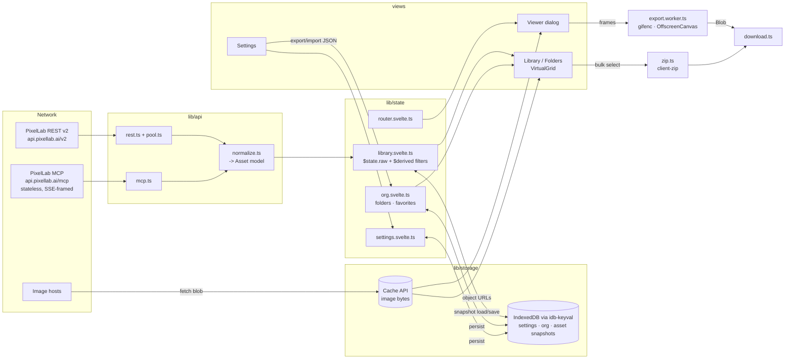

# 07 — Tech Stack and Architecture (PixelLab Gallery)

Research date: 2026-10-18. Scope: tooling, libraries, and module architecture for a fully client-side Svelte 5 single-page gallery built with Vite or Vite+, explicitly not SvelteKit, deployed to static hosting.

Method notes:
- Package versions and release dates come from the npm registry (`npm view <pkg>`), queried 2026-10-18.
- Gzip sizes were measured locally, not taken from bundlephobia. Each library was built in a throwaway Vite 8.3.4 project as an ES library, minified, with `svelte` external, and gzipped at level 9. Each entry exported only the symbols named in the table. Real tree-shaken app usage is usually smaller.
- Vite+ 1.3.0 was also smoke-tested on Windows with a minimal Svelte app (`vp build`, `vp lint`, `vp fmt`, `vp check`).
- PixelLab CORS and MCP transport behaviour was checked with unauthenticated `curl` probes on 2026-10-18 (no token, no credits used).
- Context7 MCP needed authentication and was unavailable, so sources are official docs, GitHub, npm, and vendor blogs.

---

## Summary

The recommendation is **plain Vite 8 + Svelte 5 + TypeScript 6**, plus native web platform features wherever they are good enough. That means hash routing, `<dialog>`, the Popover API, CSS anchor positioning with fallbacks, Pointer Events, the Cache API, and OffscreenCanvas.

The app ships only **four small runtime libraries**: `idb-keyval`, `@lucide/svelte`, `client-zip`, and `gifenc`. The last two are lazy-loaded. The initial JS budget, Svelte runtime included, is about 20 KB gzip plus app code.

Vite+ 1.x is now MIT-licensed and stable, and it builds Svelte fine. However, its lint, format, and type-check layers do not yet cover `.svelte` files out of the box (verified locally), so Svelte projects would still need `svelte-check`. Vite+ stays the documented fallback and future swap: it wraps the same Vite 8.3.4.

### Recommended stack

| Concern | Choice | Version (release date) | Why | Rejected alternatives |
|---|---|---|---|---|
| Build / dev server | **Vite** | 8.3.4 (2026-10-08) | Stable since 8.0.0 (2026-03-12). Rolldown is the only bundler; first-class Svelte plugin; fewest moving parts. | **Vite+ 1.3.0**: fallback, see Q1. **SvelteKit**: excluded by requirement. |
| UI framework | **Svelte** | 5.57.2 (2026-10-06) | Runes, class-based state, snippets, attachments (5.29+), `createContext` (5.40+). About 13–16 KB gzip baseline. | Experimental async `await` (5.36+): still behind a flag, so avoid in v1. |
| Svelte ↔ Vite | **@sveltejs/vite-plugin-svelte** | 7.3.1 (2026-09-23) | Peer `vite ^8`, `svelte ^5.46.4`. | — |
| Types / Svelte diagnostics | **svelte-check** + **TypeScript 6** | 4.7.7 (2026-10-16) + typescript 6.0.3 | svelte-check peers `typescript ^5 \|\| ^6`. It also surfaces Svelte compiler a11y warnings. | TypeScript 7.0.2 (Go-native, `latest` on npm): svelte-check only supports it opt-in via `--tsgo` with a dual TS6/TS7 install. |
| Routing | **Hand-rolled hash router** (~25 lines, `hashchange` + `$state`) | — | Works on any static host with no fallback config. The fragment never reaches the server. Deep links like `#/asset/character/<id>?dir=south&anim=walk`. | svelte-spa-router 5.1.1 (2.8 KB, fallback); sv-router 0.19.0 (4.3 KB, pre-1.0); @mateothegreat/svelte5-router (no release since 2025-08); Navigation API (Baseline only since 2026-01; Safari partial). |
| Persistence | **idb-keyval** (IndexedDB) + native **Cache API** + `navigator.storage.persist()` | idb-keyval 6.3.0 (2026-07-08), 0.6 KB | Thousands of records fit in memory, so filtering happens in memory and DB indexes aren't needed. Image blobs go in the Cache API. Organization data exports and imports as JSON. | idb 8.0.4 (1.5 KB, upgrade path if indexes or migrations are needed); Dexie 4.4.6 (34.6 KB, liveQuery docs are still Svelte-4 store style); localStorage (5 MiB cap, synchronous). |
| Virtualized grid | **Fixed-size square cells + hand-rolled row windowing** (~40 lines), with CSS `content-visibility` for non-virtualized lists | — | Uniform cells make windowing pure arithmetic, so no item measurement is needed. | virtua 0.53.5 (5.4–10.2 KB, Svelte ≥5, fallback if masonry is needed); @tanstack/svelte-virtual 3.13.47 (10.9 KB; store-based adapter whose getter options aren't rune-reactive); CSS-only for 5k+ items (all DOM nodes still created). |
| UI primitives | **Native** `<dialog>`, `popover`, invoker commands (`command`/`commandfor`), CSS anchor positioning with `@supports` fallback, `<input type=range>`, radio-group toggles | — | Top layer, focus trapping, Esc, and light dismiss are built in. Zero JS dependencies. | Bits UI 2.19.5 (15.5 KB for Dialog alone, 53.5 KB for 5 components; fallback for complex comboboxes or context menus); shadcn-svelte (needs Tailwind, built on Bits); Melt `melt` 0.44.0 (pre-1.0, last release 2026-01-04); Ark UI Svelte 5.24.3 (69 dependencies); Skeleton 5.0.1 (Tailwind design system). |
| Styling | **Plain CSS**: custom properties, Svelte scoped styles, `@layer`, nesting, OKLCH/`color-mix`, `light-dark()`, container queries, `image-rendering: pixelated` | — | All of these are Baseline in 2026 (dates in Q7). No build plugin needed. | Tailwind 4.3.3, UnoCSS: an extra toolchain and class vocabulary that the app doesn't need. |
| Icons | **@lucide/svelte** with per-icon deep imports | 1.59.0 (2026-10-17), ~0.4 KB per icon | Svelte-5-native, zero dependencies, ISC licence. | unplugin-icons 24.0.0 (build plugin plus config for the same result); lucide-svelte 1.0.1 (legacy package). |
| Fonts | **System font stack** in v1. If a brand or pixel font is wanted, self-host via **@fontsource-variable/** | e.g. @fontsource-variable/inter 5.3.0 | No CDN, which keeps CSP and privacy clean. | Google Fonts CDN (CSP, privacy). |
| Gestures | **Native Pointer Events** + `touch-action: none` on the viewer stage (pinch, pan, wheel, swipe) | — | About 60 lines. Integer zoom steps suit pixel art. | @use-gesture/vanilla 10.3.1 (last release 2024-03); panzoom 9.4.4; @panzoom/panzoom 4.6.2. |
| Drag to folder | **Native HTML DnD on desktop**, plus a **"Move to folder…" action** for touch and keyboard users | — | WCAG 2.2 SC 2.5.7 (AA) requires a non-drag alternative anyway. | svelte-dnd-action 0.9.80; @neodrag/svelte 2.3.3. |
| Workers | **Vite native** `new Worker(new URL('./x.worker.ts', import.meta.url), { type: 'module' })` | — | Built into Vite. One request/response message pair. | Comlink 4.4.2 (2 KB, last release 2024-11; unnecessary for one RPC). |
| ZIP | **client-zip** (lazy chunk) | 2.5.1 (2026-09-14), 2.9 KB | Streaming, store-only ZIP built for browser downloads. PNGs are already compressed. Accepts lazy async iterables, so files are fetched while zipping. | fflate 0.8.3 (5.0–6.1 KB, compression not needed); JSZip 3.10.2 (larger, older API). |
| GIF | **gifenc** (in a worker, lazy) | 1.0.3 (2021-03-07), 4.4 KB | Tiny, MIT, palette-indexed, so pixel-art palettes of 256 colours or fewer encode exactly. | modern-gif 2.1.0 (9.8 KB); gif.js 0.2.0 (unmaintained). |
| MCP client | **Hand-rolled ~40-line JSON-RPC-over-fetch client** | — | The PixelLab MCP server is stateless (no session ID) and replies with SSE framing; the client only needs POST plus SSE `data:` parsing. | @modelcontextprotocol/sdk 1.32.1 (91.7 KB gzip in the browser) and v2 @modelcontextprotocol/client 2.3.1 (88.3 KB), both with Node-oriented dependencies. |
| PWA | **Web app manifest only** in v1 (installable). Add **vite-plugin-pwa** when offline viewing becomes a requirement. | vite-plugin-pwa 2.0.0 (2026-10-03, Workbox 7.4) | Chrome install criteria list HTTPS, a manifest, and an engagement heuristic. Home-screen apps also get their own Safari 7-day storage counter. | Service worker in v1 (YAGNI). |
| Unit tests | **Vitest** (Node environment) for pure modules | 5.0.5 (2026-10-15) | Same config as Vite. | Vitest browser mode + vitest-browser-svelte 3.1.0, @testing-library/svelte 5.4.2: add when component logic grows. |
| E2E | **Playwright**: desktop and mobile projects, PixelLab API mocked via `page.route` | 1.64.1 (2026-10-14) | Covers viewports, keyboard flows, and downloads without a real token or credits. | Cypress (not evaluated). |
| Lint / format | **svelte-check** (types + a11y) + **Prettier** + **prettier-plugin-svelte** | prettier 3.9.10, plugin 4.1.1 | Mature Svelte formatting. ESLint adds little for a small app. | Oxlint 1.88.0 (no `.svelte` diagnostics in a local test); Oxfmt 0.73.0 (Svelte needs an explicit `svelte` option and is Prettier-backed); ESLint 10.13.0 + eslint-plugin-svelte 3.23.1 (optional later). |
| Hosting | **Cloudflare Workers static assets** (`_headers` for CSP) | — | Real CSP headers; free static hosting. | GitHub Pages (no custom headers, so a meta CSP can't set `frame-ancestors`); Netlify and Vercel are equivalent alternatives. |

---

## Detailed findings per question

### Q1. Vite vs Vite+

#### Takeaway
Vite 8 (Rolldown-only) is stable and is the simplest correct base. Vite+ is MIT-licensed, reached 1.0 on 2026-09-28, and builds Svelte apps. Its `lint`/`fmt`/`check` layers don't handle `.svelte` out of the box, so a Svelte project still needs `svelte-check`. **Use plain Vite 8 now; Vite+ is a low-risk later swap or fallback.**

#### Cited findings
- **Vite 8.0** was announced as stable on 2026-03-12 with Rolldown as the single bundler, replacing esbuild + Rollup, and claims 10–30x faster builds. — [Vite blog: Announcing Vite 8](https://vite.dev/blog/announcing-vite8)
  - npm confirms `vite@8.0.0` was published 2026-03-12; the latest is `8.3.4` (2026-10-08). Its dependencies include `rolldown ~1.2.12` and `lightningcss`. — [npm: vite](https://www.npmjs.com/package/vite)
  - Vite 8 keeps Node.js 20.19+ / 22.12+ as minimum requirements. — [The Register](https://theregister.com/2026/03/16/vite_8_rolldown)
  - Rolldown latest is `1.2.14` (2026-10-14). — [npm: rolldown](https://www.npmjs.com/package/rolldown)
- **What Vite+ is:**
  - A unified toolchain combining Vite, Vitest, Oxlint, Oxfmt, Rolldown, tsdown, and Vite Task in one `vite-plus` package. It also ships a global `vp` CLI that manages Node.js and the package manager.
  - Commands include `vp dev/build/preview/pack/check/lint/fmt/test/run/migrate/toolchain`.
  - `vp check` runs format, lint, and type checks together.
  - Windows x64 is Tier 1 (Windows arm64 is Tier 2), and the Windows installer is not yet code-signed. — [viteplus.dev guide](https://viteplus.dev/guide)
- **Vite+ licence history:** VoidZero first announced Vite+ as a paid offering for companies, then reversed and open-sourced it under MIT. — [VoidZero: Announcing Vite+ alpha](https://voidzero.dev/posts/announcing-vite-plus-alpha); [heise](https://heise.de/-11212433)
  - npm lists `vite-plus@1.3.0` as `license: MIT`. — [npm: vite-plus](https://www.npmjs.com/package/vite-plus)
  - No pricing tier is mentioned on the current guide. — [viteplus.dev guide](https://viteplus.dev/guide)
- **Vite+ maturity:**
  - On npm, `0.1.0` was published 2026-03-06, `1.0.0` on 2026-09-28, `1.1.0` on 2026-10-07, `1.2.0` on 2026-10-14, and `1.3.0` on 2026-10-16. — [npm: vite-plus](https://www.npmjs.com/package/vite-plus)
  - InfoQ (2026-10-14) reports 1.0 as the first stable release, about three months after the August beta. VoidZero is now part of Cloudflare.
  - InfoQ calls 1.0 "a stability milestone, not a finished product": remote caching, `vp release`, and `vp docs` are still pending, and "large projects may need follow-up work" after `vp migrate`. — [InfoQ](https://infoq.com/news/2026/10/cloudflare-viteplus-stable)
  - A Hacker News comment quoted there criticises churn: "five major versions in the four years 2022-2026". — [InfoQ](https://infoq.com/news/2026/10/cloudflare-viteplus-stable)
- **Vite+ 1.3.0 bundled tools** (from `vp --version`): vite 8.3.4, rolldown 1.2.14, vitest 5.0.5, oxfmt 0.73.0, oxlint 1.88.0, oxlint-tsgolint 7.0.2004, tsdown 0.23.1. It aliases `vite` to `npm:@voidzero-dev/vite-plus-core@1.3.0`. — [npm: vite-plus](https://www.npmjs.com/package/vite-plus) and local test.
- **Local Svelte smoke test on Windows** (Vite+ 1.3.0 + vite-plugin-svelte 7.3.1, `defineConfig` from `vite-plus`):
  - `vp build` worked and produced a 12.99 KB gzip bundle.
  - `vp lint src` flagged an unused variable in a `.ts` file but reported nothing for an unused variable in a `.svelte` `<script>`.
  - `vp fmt --check src/App.svelte` reported "Expected at least one target file", so `.svelte` was skipped with default config.
  - Source: local test, not documented by VoidZero.
- **Oxfmt Svelte formatting** requires the `svelte` package and enabling the `svelte` option. It is Prettier-backed, and the docs note the Prettier-backed list shrinks as languages are ported to Rust. — [Oxc formatter language support](https://oxc.rs/docs/guide/usage/formatter/language-support.html)
- **npm install quirk:** `npm i -D vite-plus svelte-check typescript@6 ...` in one command resolved to the pre-1.0 `vite-plus@0.3.3` (2026-09-18) without warning. Pinning `vite-plus@1.3.0` then failed with an `ERESOLVE` peer conflict on `vitest@5.0.5` / `@vitest/browser-playwright`. Installing `vite-plus@1.3.0` first, then the Svelte packages, worked. — local test.

#### Inferences
- With Vite+ on a Svelte project you would still run `svelte-check` separately. `vp check`'s type layer is tsgolint (TS7-based) and cannot type-check `.svelte` files; that is an inference from the tool list, not tested exhaustively. You would also likely configure Prettier or the Oxfmt `svelte` option. The "one CLI" benefit is therefore partial for Svelte today.
- Because Vite+ wraps the same Vite version and reads the same `vite.config.ts`, starting on plain Vite costs nothing if the team later runs `vp migrate`.
- **Recommendation:** plain Vite 8 (`npm create vite@latest -- --template svelte-ts`), with Vite+ as the fallback.

#### Gaps
- No official VoidZero statement was found on Svelte-specific support in `vp check`/`vp lint`.
- The exact Vite+ alpha open-sourcing date is inconsistent across secondary sources.

### Q2. Svelte 5 status

#### Takeaway
Svelte 5.57.2 is current. Runes, class state, snippets, attachments (5.29+), and `createContext` (5.40+) are all stable. Async `await` in components (5.36+) is **still experimental** and the flag will only be removed in Svelte 6, so avoid it in v1. Use `$state.raw` for large asset arrays.

#### Cited findings
- **Versions:**
  - `svelte@5.57.2` was released 2026-10-06; `5.0.0` was released 2024-10-19. — [npm: svelte](https://www.npmjs.com/package/svelte)
  - The October 2026 "What's new" post lists Svelte 5.57.1 as "all bug fixes and parser performance work", and `sv@1.0.0` (the Svelte CLI) reached 1.0. — [What's new in Svelte: October 2026](https://svelte.dev/blog/whats-new-in-svelte-october-2026)
- **Async:**
  - "This feature is currently experimental, and you must opt in by adding the `experimental.async` option"
  - "As of Svelte 5.36, you can use the `await` keyword…"
  - "The experimental flag will be removed in Svelte 6."
  - Source: [Svelte docs: await expressions](https://svelte.dev/docs/svelte/await-expressions)
- **Attachments:** "Attachments are available in Svelte 5.29 and newer". Unlike actions they are "fully reactive", and `fromAction` converts existing actions. — [Svelte docs: {@attach}](https://svelte.dev/docs/svelte/@attach)
- **Context:** "`createContext` was added in version 5.40". It returns a type-safe `[get, set, has]` triplet and is preferred over `setContext`/`getContext`. Module-level shared state is fine "in many cases"; the warning against it is about SSR data leaking between requests. — [Svelte docs: context](https://svelte.dev/docs/svelte/context)
- **State:**
  - `$state` on arrays and objects creates deep proxies.
  - `$state.raw` "cannot be mutated; it can only be reassigned" and "avoids the cost of making them reactive" for large data.
  - Class instances aren't proxied; use `$state` class fields instead.
  - Reassigned state can't be exported directly from `.svelte.ts`; export an object or getter functions instead.
  - Source: [Svelte docs: $state](https://svelte.dev/docs/svelte/$state)
- **Plugin and tooling:**
  - `@sveltejs/vite-plugin-svelte@7.3.1` (2026-09-23) peers `vite ^8`, `svelte ^5.46.4`; 7.0.0 was released 2026-02-23. — [npm](https://www.npmjs.com/package/@sveltejs/vite-plugin-svelte)
  - `svelte-check@4.7.7` (2026-10-16) peers `typescript ^5.0.0 || ^6.0.0`. — [npm: svelte-check](https://www.npmjs.com/package/svelte-check)
- **TypeScript 7:**
  - `typescript@latest` is `7.0.2` (2026-07-08); `6.0.3` is the latest 6.x (2026-04-16). — [npm: typescript](https://www.npmjs.com/package/typescript)
  - svelte-check's README says TypeScript 7 support is opt-in via `--tsgo` and needs both TS7 and TS6 installed, with TS7 aliased as `@typescript/native`. — [svelte-check README (unpkg 4.7.6)](https://unpkg.com/svelte-check@4.7.6/README.md)

#### Inferences
- Pin `"typescript": "~6.0.3"` in devDependencies. A bare `npm i -D typescript` now installs 7.x, which svelte-check doesn't peer.
- The app has no SSR, so module-level `$state` in `.svelte.ts` files is a valid, simpler alternative to context for app-wide stores (settings, library, org). Use `createContext` only for subtree-scoped state.
- Store the asset list as `$state.raw` and replace the array on sync. Proxying thousands of nested asset objects is wasted work, because assets are read-only from the UI's perspective.

#### Gaps
- No official Svelte 6 date was found.

### Q3. Client-side routing without SvelteKit

#### Takeaway
Use a **hand-rolled hash router** (~25 lines). Hash URLs work on every static host without SPA-fallback config. They keep asset IDs out of server logs and Referer headers, and they support deep links and back-button-closes-viewer. svelte-spa-router 5.1.1 is the fallback.

#### Cited findings
- "The fragment is not sent to the server when the URI is requested; it is processed by the client". — [MDN: URI fragment](https://developer.mozilla.org/en-US/docs/Web/URI/Reference/Fragment)
- **svelte-spa-router 5.1.1** (2026-06-25):
  - Peers `svelte ^5`, is hash-only, and parses a querystring inside the hash (e.g. `#/books?show=authors`). — [npm: svelte-spa-router](https://www.npmjs.com/package/svelte-spa-router)
  - Measured 2.8 KB gzip.
- **sv-router 0.19.0** (2026-09-11):
  - Pre-1.0, with type-safe routes, optional file-based routing, and hash mode; it claims "~ 5kB gzipped". — [npm: sv-router](https://www.npmjs.com/package/sv-router)
  - Measured 4.3 KB gzip.
- **@mateothegreat/svelte5-router 2.16.19:** the npm metadata was last modified 2025-08-29, i.e. no 2026 releases. — [npm](https://www.npmjs.com/package/@mateothegreat/svelte5-router)
- **Navigation API:**
  - Baseline Newly available on 2026-01-13 (Chrome 102, Firefox 147, Safari 26.2). — [web.dev: New to the web platform in January 2026](https://web.dev/blog/web-platform-01-2026); `web-features` 3.43.0
  - Safari lacked `precommitHandler` as of May 2026. — [InfoQ](https://infoq.com/news/2026/05/navigation-api-browser)
- **GitHub Pages** has no route handling. The SPA workaround is a custom `404.html` that redirects into `index.html`, and it still returns HTTP 404. — [Smashing Magazine: S(GH)PA](https://www.smashingmagazine.com/2016/08/sghpa-single-page-app-hack-github-pages/); [garrit.xyz](https://garrit.xyz/posts/2023-06-01-single-page-applications-on-github-pages)
- **Cloudflare Workers static assets** provides history-mode SPA fallback via `assets.not_found_handling = "single-page-application"`, which serves `/index.html` with 200 for unmatched paths. — [Cloudflare: SPA routing](https://developers.cloudflare.com/workers/static-assets/routing/single-page-application/)

#### Proposed router (illustrative)
```ts
// src/lib/state/router.svelte.ts
// ponytail: hash router; swap for svelte-spa-router if nested layouts/guards appear
export const route = $state({ path: '/', query: new URLSearchParams() });
function read() {
  const [path, q = ''] = location.hash.slice(1).split('?');
  route.path = path || '/';
  route.query = new URLSearchParams(q);
}
addEventListener('hashchange', read);
read();

let openedInApp = false; // did *we* push the viewer entry?
export function go(to: string, { replace = false } = {}) {
  openedInApp = !replace;
  replace ? location.replace('#' + to) : (location.hash = to);
}
export function closeViewer(fallback = '/') {
  // Back button and the close button behave the same; a deep-linked open replaces instead.
  openedInApp ? history.back() : go(fallback, { replace: true });
}
// match: const m = route.path.match(/^\/asset\/([^/]+)\/([^/]+)$/) -> type, id
```
Viewer URL format: `#/asset/character/<id>?dir=south&anim=walk&frame=0`. Changing direction or animation inside the viewer uses `replace` so Back still closes the viewer in one step.

#### Inferences
- History mode only buys prettier URLs, at the cost of host-specific fallback config. That has no value for an authenticated, non-SEO app.
- The Navigation API is not needed: `hashchange` covers everything here and is universally supported.

#### Gaps
- None material.

### Q4. Persistence

#### Takeaway
Use **idb-keyval** (0.6 KB) for settings, folders/favorites, and the metadata cache. Load all of it into memory and filter there. Store image bytes in the **Cache API**, call `navigator.storage.persist()`, and make **JSON export/import** of the organization a first-class feature, because Safari can evict non-installed sites' storage after 7 days without interaction.

#### Cited findings
- **Sizes and dates** (measured gzip): idb-keyval 6.3.0 (2026-07-08) 0.6 KB; idb 8.0.4 (2026-10-06) 1.5 KB; Dexie 4.4.6 (2026-09-10) 34.6 KB for `Dexie` + `liveQuery`. — [npm: idb-keyval](https://www.npmjs.com/package/idb-keyval); [npm: idb](https://www.npmjs.com/package/idb); [npm: dexie](https://www.npmjs.com/package/dexie)
- **Dexie's Svelte docs:**
  - `liveQuery()` returns an Observable that follows the Svelte store contract.
  - The examples use Svelte 4 syntax (`$:` and `$store`); Svelte 5 runes aren't mentioned.
  - Source: [Dexie: Svelte tutorial](https://dexie.org/docs/Tutorial/Svelte)
- **Safari eviction:**
  - Safari "proactively evicts data … If an origin has no user interaction … in the last seven days of browser use, its data created from script will be deleted." — [MDN: Storage quotas and eviction criteria](https://developer.mozilla.org/en-US/docs/Web/API/Storage_API/Storage_quotas_and_eviction_criteria)
  - "Web applications added to the home screen are not part of Safari and thus have their own counter of days of use." — [WebKit blog](https://webkit.org/blog/10218/full-third-party-cookie-blocking-and-more/)
- **Persistence and quotas:**
  - `navigator.storage.persist()` exempts an origin from storage-pressure eviction.
  - Firefox prompts the user; Chrome and Safari auto-decide based on engagement.
  - Quotas: Chromium allows about 60% of disk; Safari about 60% per origin; Firefox best-effort is min(10% of disk, 10 GiB).
  - IndexedDB and Cache API data are managed and evicted together.
  - Source: [MDN: Storage quotas and eviction criteria](https://developer.mozilla.org/en-US/docs/Web/API/Storage_API/Storage_quotas_and_eviction_criteria)
- **Baseline status:** the StorageManager API has been Baseline Widely available since 2026-03-18, and IndexedDB since 2024-03-20. — `web-features` 3.43.0 ([web-features](https://github.com/web-platform-dx/web-features))

#### Inferences
- **Data layout in idb-keyval** (one DB, one store):
  - `settings` (token handling decided separately, see Risks)
  - `org` = `{ version, folders: [{id, name, assetKeys[]}], favorites: assetKey[] }`
  - `assets:<type>` = normalized list snapshot plus `syncedAt`
  - `asset:<key>` = detail payloads
- Thousands of assets serialize to a few MB at most. One `getMany`/`entries` at startup plus in-memory `$derived` filtering beats IndexedDB indexes on simplicity.
- Upgrade to `idb` if schema migrations or indexed range queries become necessary.
- Use the Cache API for images when they are URL-addressable: `cache.put(url, response)`. If the API returns base64 in JSON, decode it to a `Blob` and store it in the idb-keyval store instead. The image delivery format depends on the API research (see other notes).
- Export/import of the organization uses `JSON.stringify(org)` → `Blob` → `a[download]`, and `<input type=file>` → `JSON.parse`, validated with a version number and a shape check.

#### Gaps
- Whether PixelLab image URLs are stable (cacheable by URL) or signed and expiring was not verified here.

### Q5. Virtualized grid for thousands of items

#### Takeaway
Render **uniform square cells** with the pixel art scaled to fit. Use a **~40-line row-windowing component**: column count from `ResizeObserver`, rows from scroll offset, a fixed row height, and overscan. It has zero dependencies and handles 10k+ items. Use `content-visibility: auto` only for smaller, non-virtualized lists. Fallback: **virtua 0.53.5**, if variable-height or masonry layouts become a requirement.

#### Cited findings
- **Lighthouse DOM-size thresholds:** it "Warns when the body element has more than ~800 nodes" and "Errors when … more than ~1,400 nodes". It recommends windowing or creating nodes on demand. — [Chrome: Avoid an excessive DOM size](https://developer.chrome.com/docs/lighthouse/performance/dom-size)
- **`content-visibility: auto`:**
  - Skips style, layout, and paint for off-screen subtrees; the example went from 232 ms to 30 ms rendering (7x).
  - Content "remains available in the document object model" and stays in the accessibility tree and find-in-page.
  - `contain-intrinsic-size: auto` remembers the last-rendered size.
  - Source: [web.dev: content-visibility](https://web.dev/articles/content-visibility)
  - Baseline: content-visibility became Baseline Newly available 2025-09-15; contain-intrinsic-size is Widely available (2026-03-18). — `web-features` 3.43.0
- **TanStack Virtual:**
  - The Svelte adapter's `createVirtualizer` returns a Svelte store. A TanStack-published skill guide notes it doesn't track getter options and recommends pushing rune values via `$effect` + `setOptions`. — [TanStack Virtual Svelte docs](https://tanstack.com/virtual/latest/docs/framework/svelte/svelte-virtual); [TanStack Table skill reference (unpkg)](https://unpkg.com/@tanstack/svelte-table@9.2.8/skills/getting-started/references/with-tanstack-virtual.md)
  - `@tanstack/svelte-virtual@3.13.47` peers `svelte ^3 || ^4 || ^5`; measured 10.9 KB gzip. — [npm](https://www.npmjs.com/package/@tanstack/svelte-virtual)
- **virtua:**
  - Supports Svelte ≥5 with `VList`, `Virtualizer`, `WindowVirtualizer`, `VGrid`, and `VMasonry`; `VGrid` requires CSS subgrid. — [npm: virtua](https://www.npmjs.com/package/virtua)
  - Measured 5.4 KB gzip (`VList` + `Virtualizer`) and 10.2 KB (`VGrid` + `WindowVirtualizer`); version 0.53.5 (2026-10-12).

#### Inferences
- The CSS-only approach still creates every card's DOM nodes and Svelte effects up front. That means 5,000 cards × ~5 nodes ≈ 25k nodes, well past Lighthouse's 1,400 error threshold, with slow initial mount and high memory on low-end phones. It is fine up to a few hundred items: folder lists, a single animation's frames.
- Uniform cells turn windowing into arithmetic:
  - `cols = max(1, floor(width / minCell))`
  - `rows = ceil(n / cols)`
  - `first = floor(scrollTop / rowH) - overscan`
  - Render rows `first..last` absolutely positioned inside a spacer of `rows × rowH`.
  - No per-item measurement is needed, which is the hard part libraries solve.
- **Accessibility for the windowed grid:**
  - Use `role="list"` with `aria-setsize` and `aria-posinset` on items so screen readers announce the totals.
  - Provide a search/filter box, because browser find-in-page can't see unrendered cards.
  - Keep keyboard focus by scrolling the focused index into view before moving focus.

#### Gaps
- No Svelte-5-specific benchmark at 5k–10k items was found. The team should measure on a mid-range Android device before deciding the CSS-only threshold.

### Q6. UI primitives and accessibility

#### Takeaway
Native HTML now covers almost everything needed:
- `<dialog>` for the viewer, settings, and bottom sheet.
- `popover` for menus.
- Invoker commands to open and close without JS.
- CSS anchor positioning to place menus, with an `@supports` fallback.
- `<input type=range>` for sliders.
- Radio groups for toggle groups.

Two gaps need a few lines of JS: `closedby` (missing in Safari, so handle backdrop clicks manually) and arrow-key roving focus in menus. Bits UI is the fallback for genuinely complex widgets.

#### Cited findings
- **`<dialog>`:** Baseline Widely available (supported across browsers since March 2022). Invoker commands `show-modal`, `close`, and `request-close` target it. — [MDN: dialog](https://developer.mozilla.org/docs/Web/HTML/Reference/Elements/dialog)
- **Invoker commands (`command`/`commandfor`):**
  - Chrome 135, Firefox 144, Safari 26.2; Baseline Newly available 2025-12-12. — [InfoQ](https://www.infoq.com/news/2026/01/html-invoker-commands)
  - Also confirmed by `@mdn/browser-compat-data` 8.1.6 and `web-features` 3.43.0.
- **Popover API:** Chrome 114, Firefox 125, Safari 17; Baseline Newly available 2025-01-27. — `web-features` 3.43.0
- **`dialog closedby`:** Chrome 134, Firefox 141, Safari only in Technology Preview, so not Baseline. `HTMLDialogElement.requestClose()` works in Chrome 134, Firefox 139, Safari 18.4. — `@mdn/browser-compat-data` 8.1.6
- **CSS anchor positioning:**
  - web.dev says Firefox 147 made it Baseline Newly available (Chrome 125, Safari 26). — [web.dev: January 2026](https://web.dev/blog/web-platform-01-2026)
  - **Conflict:** `web-features` 3.43.0 marks the `anchor-positioning` group `baseline: false`, because the `position-visibility: anchor-valid/anchor-visible` sub-features only arrive in Safari 27.
  - Core `anchor-name` and `position-try-fallbacks` ship in Chrome 125/128, Firefox 147, Safari 26 (BCD 8.1.6).
- **`interestfor`** (hover/focus tooltips): Chrome 142 only. **`popover="hint"`:** Chrome 151 and Firefox 153, Safari preview. — BCD 8.1.6
- **Library candidates:**
  - **Bits UI 2.19.5** (2026-10-03) peers `svelte ^5.33.0` and `@internationalized/date`; measured 15.5 KB gzip for `Dialog` alone and 53.5 KB for `Dialog` + `DropdownMenu` + `Tooltip` + `Slider` + `ToggleGroup`. — [npm: bits-ui](https://www.npmjs.com/package/bits-ui)
  - **Melt `melt` 0.44.0:** last release 2026-01-04, peers `@floating-ui/dom`.
  - **@ark-ui/svelte 5.24.3:** 69 runtime dependencies.
  - **@skeletonlabs/skeleton 5.0.1:** 2026-08-19.
  - Source: npm registry

#### Inferences
- **Minimal native set:**
  - Viewer and Settings: `<dialog>` + `showModal()`. Bottom sheet on mobile: the same `<dialog>` styled to the bottom edge, with `@starting-style` (Baseline 2024-08) for the entry transition.
  - Menus: `popover` + `anchor-name`/`position-anchor`, with `@supports not (anchor-name: --a)` falling back to a fixed or centered menu.
  - Tooltips: avoid hover-only tooltips. Use visible labels or `aria-label` plus `title` for desktop hints; `interestfor` isn't cross-browser.
  - Slider: `<input type=range>` (animation speed, zoom).
  - Toggle group: `<fieldset>` of styled radios (direction picker, grid size).
- **JS needed** (about 30 lines total): backdrop-click-to-close (check `event.target === dialog`), and arrow-key, Home/End, and typeahead roving focus in menus per the WAI-ARIA menu pattern.
- Re-evaluate Bits UI only if a combobox, date picker, or nested context menu appears.

#### Gaps
- No authoritative 2026 accessibility audit of native popover menus with screen readers was found; manual VoiceOver/NVDA testing is advised.

### Q7. Styling

#### Takeaway
Use plain CSS: tokens as custom properties in a global `@layer` stylesheet, plus Svelte component-scoped styles. Every modern feature on the list is Baseline. Tailwind and UnoCSS add a toolchain for no product gain.

#### Cited findings (`web-features` 3.43.0 Baseline status)

| Feature | Baseline status | Since |
|---|---|---|
| container queries | Widely available | 2025-08-14 |
| `:has()` | Widely available | 2026-06-19 |
| CSS nesting | Widely available | 2026-06-11 |
| `@layer` (cascade layers) | Widely available | 2024-09-14 |
| `color-mix()` | Widely available | 2025-11-09 |
| OKLab/OKLCH | Widely available | 2025-11-09 |
| `light-dark()` | Newly available | 2024-05-13 |
| `@property` | Newly available | 2024-07-09 |
| `@starting-style` | Newly available | 2024-08-06 |
| same-document view transitions | Newly available | 2025-10-14 |
| `@scope` | Newly available | 2026-03-24 |
| `image-rendering` (incl. `pixelated`) | Widely available | 2024-04-05 |
| cross-document view transitions | Not Baseline (no Firefox) | — |
| anchor positioning | See Q6 (conflicting status) | — |

- Source: [web-features](https://github.com/web-platform-dx/web-features); same-document view transitions also via BCD (`startViewTransition`: Chrome 111, Firefox 144, Safari 18).
- `tailwindcss@4.3.3` was released 2026-07-16. — [npm](https://www.npmjs.com/package/tailwindcss)

#### Inferences
- `image-rendering: pixelated` plus integer CSS scaling (`width: calc(var(--w) * var(--zoom) * 1px)`) is the core pixel-art rendering rule. Avoid fractional scaling in the viewer; snap zoom to integers.
- Use `document.startViewTransition` for grid → viewer morphs as progressive enhancement. It is a no-op where unsupported.
- Use container queries for card layouts, so the same card works in the grid, sidebar, and sheet.

#### Gaps
- None.

### Q8. Icons and fonts

#### Takeaway
Use `@lucide/svelte` with deep per-icon imports (about 0.4 KB gzip each, zero dependencies). Use the system font stack in v1; if a typeface is wanted later, self-host via `@fontsource-variable/*`.

#### Cited findings
- `@lucide/svelte@1.59.0` (2026-10-17): peer `svelte ^5`, ISC licence, 0 dependencies. Measured 2.2 KB gzip for 5 icons. — [npm](https://www.npmjs.com/package/@lucide/svelte)
- `lucide-svelte@1.0.1` (last modified 2026-05-15) is the older package. — [npm](https://www.npmjs.com/package/lucide-svelte)
- `unplugin-icons@24.0.0` (2026-09-11) supports Svelte 5 as a build plugin. — [npm](https://www.npmjs.com/package/unplugin-icons)
- `@fontsource-variable/inter@5.3.0` (2026-07-19) is OFL-1.1. — [npm](https://www.npmjs.com/package/@fontsource-variable/inter)

#### Inferences
- Deep imports (`import Heart from '@lucide/svelte/icons/heart'`) avoid any barrel-file tree-shaking doubt.
- Fonts are not on the critical path for a pixel-art gallery. The art carries the brand.

#### Gaps
- No Lucide-specific Svelte 5 performance data was collected; the measured size is enough.

### Q9. Gestures and drag-and-drop

#### Takeaway
Use native Pointer Events for pinch-zoom, pan, wheel-zoom, and swipe in the viewer (about 60 lines, integer zoom steps). Use native HTML DnD for desktop folder drops. For touch and keyboard users, add a "Move to folder…" action on the multi-select toolbar, which WCAG 2.2 requires anyway.

#### Cited findings
- **WCAG 2.2 SC 2.5.7 Dragging Movements (Level AA):** "All functionality that uses a dragging movement for operation can be achieved by a single pointer without dragging". — [W3C Understanding 2.5.7](https://www.w3.org/WAI/WCAG22/Understanding/dragging-movements.html)
- **Pointer Events:** Baseline Widely available since 2018-01-29. **touch-action:** Widely available since 2022-03-19. — `web-features` 3.43.0
- **Gesture libraries:**
  - `@use-gesture/vanilla@10.3.1`: last modified 2024-03-21.
  - `panzoom@9.4.4`
  - `@panzoom/panzoom@4.6.2`
  - Source: npm registry

#### Inferences
- **Viewer gesture model:**
  - Track active pointers in a `Map`. Two pointers drive pinch (distance ratio → zoom), one pointer drives pan.
  - `wheel` with `ctrlKey` or plain wheel zooms around the cursor.
  - A horizontal swipe with velocity > threshold at zoom 1 means next/previous asset.
  - Use `touch-action: none` on the stage only, so page scrolling elsewhere stays native.
  - Keyboard: `+`/`-`/`0`, arrows, and Esc (Esc comes free from `<dialog>`).
- HTML DnD covers desktop. Touch drag support varies and isn't needed once the action menu exists.

#### Gaps
- Current mobile-browser HTML DnD support was not verified (it is irrelevant given the action-menu path).

### Q10. Export workers

#### Takeaway
Use Vite's built-in worker syntax with a single `postMessage({job}) → postMessage(Blob)` protocol; no Comlink. Run GIF encoding (gifenc) and large sprite-sheet composition in a worker with `OffscreenCanvas`. Build ZIPs with client-zip, which streams lazily and doesn't need a worker.

#### Cited findings
- Vite supports `new Worker(new URL('./worker.js', import.meta.url), { type: 'module' })` and `?worker` imports. — [Vite: Features → Web Workers](https://vite.dev/guide/features#web-workers)
- **OffscreenCanvas:** Widely available (2025-09-27). **createImageBitmap:** Widely available (2026-06-11). **CompressionStream:** Widely available (2025-11-09). — `web-features` 3.43.0
- **`showSaveFilePicker`:** Chrome only (Firefox and Safari: no). **`ImageDecoder`:** Chrome 94, Firefox 133, Safari preview only. — BCD 8.1.6
- **Sizes** (measured gzip):
  - client-zip 2.5.1 (2026-09-14, MIT): 2.9 KB
  - gifenc 1.0.3 (2021-03-07, MIT): 4.4 KB
  - fflate 0.8.3: 5.0 KB (`zipSync`) / 6.1 KB (`zip`)
  - modern-gif 2.1.0: 9.8 KB
  - comlink 4.4.2 (last release 2024-11-07): 2.0 KB
  - Source: npm registry

#### Inferences
- Single PNG download: if the API already gives PNG bytes, use `fetch → blob → a[download]`. No canvas means no colour or alpha drift.
- Sprite sheet: draw frames onto `OffscreenCanvas`, then `convertToBlob({ type: 'image/png' })`.
- GIF:
  - Build an exact palette from the frames (pixel art usually has 256 colours or fewer) and only quantize if there are more.
  - Map transparency to one palette index.
  - Note that GIF has 1-bit alpha, so semi-transparent pixels must be thresholded. Warn the user.
- Bulk ZIP: `downloadZip(asyncIterableOfFiles).blob()`, with files fetched lazily (bounded concurrency) as the ZIP streams. The final ZIP is a `Blob` in memory.
  - Streaming straight to disk is possible only via Chromium's `showSaveFilePicker`. That's YAGNI unless very large exports fail in testing.

#### Gaps
- Whether PixelLab image hosts send CORS headers wasn't tested (it needs a token). Without them, canvas-based exports (sprite sheets, GIFs) would be tainted. See Risks.

### Q11. MCP from the browser

#### Takeaway
The official SDK runs in browsers but costs about 88–92 KB gzip and pulls in Node-oriented dependencies. The PixelLab MCP server is **stateless**, replies with **SSE-framed** bodies, and allows CORS from any origin. A ~40-line fetch client is simpler and fully spec-compliant for `tools/call`.

#### Cited findings
- **Streamable HTTP spec (2025-06-18):**
  - The client "MUST include an `Accept` header, listing both `application/json` and `text/event-stream`".
  - The server returns either `text/event-stream` or `application/json`, and "The client MUST support both".
  - A server "MAY assign a session ID"; if returned, the client "MUST include it … on all of their subsequent HTTP requests".
  - Clients send `MCP-Protocol-Version` on subsequent requests.
  - Source: [MCP spec: Transports](https://modelcontextprotocol.io/specification/2025-06-18/basic/transports)
- **SDK packages:**
  - `@modelcontextprotocol/sdk@1.32.1` (2026-10-05) has 17 dependencies (express, hono, cors, ajv, jose, cross-spawn, eventsource, …) and peers zod. — [npm](https://www.npmjs.com/package/@modelcontextprotocol/sdk)
  - The v2 split package `@modelcontextprotocol/client@2.3.1` (2026-10-05, Apache-2.0) depends on zod 4, jose, cross-spawn, eventsource, and pkce-challenge, and ships a `_shims` browser export. — [npm](https://www.npmjs.com/package/@modelcontextprotocol/client)
  - Measured browser bundle for `Client` + `StreamableHTTPClientTransport`: 91.7 KB gzip (SDK v1), 88.3 KB gzip (v2 client).
- **PixelLab probe** (unauthenticated `curl`, 2026-10-18):
  - `OPTIONS https://api.pixellab.ai/mcp` and `/v2/balance` with `Origin: https://example.pages.dev` returned 200. The response included `access-control-allow-origin` echoing that origin, `allow-headers: authorization,content-type,mcp-session-id,mcp-protocol-version`, and `max-age: 600`.
  - A `POST /mcp` `initialize` returned `200 Content-Type: text/event-stream` with one `event: message` / `data: {…InitializeResult…}`. The server identified itself as "PixelLab MCP Server" 0.2.0 with protocol `2025-06-18`. **No `Mcp-Session-Id` header** was returned.
  - A fresh `tools/list` POST without any session or initialize succeeded.
  - `access-control-expose-headers` was only `Content-Disposition`, so browser JS cannot read any other non-safelisted response header (session ID, rate-limit headers). — local probe; header semantics per [MDN: Access-Control-Expose-Headers](https://developer.mozilla.org/en-US/docs/Web/HTTP/Reference/Headers/Access-Control-Expose-Headers)
- MCP auth uses the same `Authorization: Bearer <secret>` header as REST. — pixellab-pip `references/credentials.md` (sibling repo)

#### Proposed client (illustrative)
```ts
// src/lib/api/mcp.ts — ponytail: stateless JSON-RPC over fetch; add session handling only if PixelLab starts issuing Mcp-Session-Id (and exposes it via CORS)
const URL_ = 'https://api.pixellab.ai/mcp';
let seq = 0;
export async function mcpCall<T = unknown>(token: string, method: string, params?: object): Promise<T> {
  const id = ++seq;
  const res = await fetch(URL_, {
    method: 'POST',
    headers: {
      'Content-Type': 'application/json',
      Accept: 'application/json, text/event-stream',
      Authorization: `Bearer ${token}`,
      'MCP-Protocol-Version': '2025-06-18',
    },
    body: JSON.stringify({ jsonrpc: '2.0', id, method, params }),
  });
  if (!res.ok) throw new Error(`MCP HTTP ${res.status}`);
  const text = await res.text();
  const msgs = (res.headers.get('content-type') ?? '').includes('text/event-stream')
    ? text.split(/\r?\n\r?\n/)
        .map(ev => ev.split(/\r?\n/).filter(l => l.startsWith('data:')).map(l => l.slice(5).trimStart()).join('\n'))
        .filter(Boolean).map(d => JSON.parse(d))
    : [JSON.parse(text)];
  const msg = msgs.find(m => m.id === id);
  if (!msg) throw new Error('MCP: no response for request');
  if (msg.error) throw new Error(`MCP ${msg.error.code}: ${msg.error.message}`);
  return msg.result as T;
}
// tools/call -> result.content[] ({type:'text'|'image'|'resource_link', ...}), result.isError, result.structuredContent?
export const callTool = (token: string, name: string, args: object) =>
  mcpCall<{ content: any[]; isError?: boolean; structuredContent?: unknown }>(token, 'tools/call', { name, arguments: args });
```

#### Inferences
- The SDK would roughly quintuple the initial JS budget to deliver features the gallery doesn't use: server-initiated requests, resumability, OAuth flows, and stdio. The hand-rolled client still follows the spec's MUSTs: the `Accept` header, handling both response content types, and the protocol-version header.
- Call `initialize` once per app load anyway, to check `protocolVersion` and catch auth errors early. The server doesn't require it today.

#### Gaps
- Authenticated responses (session ID presence, content shapes of the Creator-gallery list tools, pagination) were not probed, to avoid using the user's token. Other research notes cover the PixelLab API surface.

### Q12. PWA

#### Takeaway
v1 ships **only a web app manifest** (name, icons 192/512, `start_url`, `display: standalone`). That gives installability and, on Safari, a separate storage-eviction counter for home-screen installs. Add `vite-plugin-pwa` 2.0 (generateSW) later, only when offline viewing of cached assets becomes a stated requirement.

#### Cited findings
- **Chrome install criteria:** the app isn't already installed; the user clicked or tapped at least once and viewed for 30+ seconds; the site uses HTTPS; and the manifest has a name or short_name, 192 px and 512 px icons, `start_url`, an allowed `display` mode, and `prefer_related_applications` not set to true. A service worker is not listed. — [web.dev: Install criteria](https://web.dev/articles/install-criteria)
- **vite-plugin-pwa:**
  - `2.0.0` (2026-10-03): the breaking change allows `@vite-pwa/assets-generator ^2.0.0`. — [GitHub release v2.0.0](https://github.com/vite-pwa/vite-plugin-pwa/releases/tag/v2.0.0)
  - `1.3.0` (2026-05-05) added the Vite 8 peer. — [GitHub release v1.3.0](https://github.com/vite-pwa/vite-plugin-pwa/releases/tag/v1.3.0)
  - Peers `workbox-build`/`workbox-window ^7.4.1`. — [npm](https://www.npmjs.com/package/vite-plugin-pwa)
- **Home-screen storage counter:** home-screen web apps have their own counter of days of use. — [WebKit blog](https://webkit.org/blog/10218/full-third-party-cookie-blocking-and-more/)
- **Service workers:** Baseline Widely available (2020-10-30). — `web-features` 3.43.0

#### Inferences
- Image blobs already live in the Cache API (Q4). A later service worker can serve them offline with little extra work.
- An app-shell service worker adds an update-flow UX ("new version available") that v1 doesn't need.

#### Gaps
- Firefox desktop installability is not covered by the source.

### Q13. Testing and quality

#### Takeaway
- Vitest 5 (Node environment) for pure logic: normalizers, router parsing, ZIP manifest building, palette extraction.
- Playwright 1.64 for e2e on desktop and mobile projects, with PixelLab mocked through `page.route`.
- svelte-check for types and compiler a11y warnings.
- Prettier + prettier-plugin-svelte for formatting.

Component-level browser tests (vitest-browser-svelte) are deferred.

#### Cited findings
- **Svelte's testing guidance:**
  - "we recommend using Vitest". Rune tests go in files whose name includes `.svelte` (e.g. `x.svelte.test.ts`), using `$effect.root` and `flushSync()`.
  - Component tests can use jsdom + `mount` or @testing-library/svelte.
  - For e2e, Playwright with `webServer` building and previewing the app.
  - Source: [Svelte docs: Testing](https://svelte.dev/docs/svelte/testing)
- **Versions** (npm registry):
  - vitest 5.0.5 (2026-10-15; 5.0.0 on 2026-09-03; peers `vite ^6.4 || ^7 || ^8`)
  - @vitest/browser-playwright 5.0.5
  - vitest-browser-svelte 3.1.0 (2026-09-04; peers `vitest ^4 || ^5`)
  - @testing-library/svelte 5.4.2 (2026-06-23)
  - @playwright/test 1.64.1 (2026-10-14)
  - eslint 10.13.0
  - eslint-plugin-svelte 3.23.1 (peers `eslint ^8.57.1 || ^9 || ^10`)
  - prettier 3.9.10
  - prettier-plugin-svelte 4.1.1 (peers `prettier ^3`, `svelte ^5`)
  - oxlint 1.88.0
  - oxfmt 0.73.0 (peer `svelte ^5` optional)
- **Oxlint/Oxfmt on `.svelte`** (local test): see Q1. Oxfmt can format `.svelte` only with the `svelte` option enabled. — [Oxc formatter language support](https://oxc.rs/docs/guide/usage/formatter/language-support.html)

#### Inferences
- A mocked-API Playwright suite is the highest-value test. It exercises routing, virtualization, dialogs, keyboard, and downloads (`page.waitForEvent('download')`) at 375×812 and 1440×900 without credits.
- ESLint is optional. svelte-check already surfaces Svelte's a11y and compiler warnings. Add eslint-plugin-svelte only if a recurring defect class appears.

#### Gaps
- No comparison of Vitest browser mode speed on Windows was done.

### Q14. Deployment and CSP

#### Takeaway
Deploy to **Cloudflare Workers static assets** (or Netlify/Vercel), with a strict CSP in `_headers`. Hash routing means no SPA fallback is needed. GitHub Pages works as a fallback with a `<meta>` CSP, but it can't set `frame-ancestors` (clickjacking protection) or reporting.

#### Cited findings
- **Cloudflare `_headers`:**
  - A `_headers` file in the assets directory: "You may define up to 100 header rules" and "Each line in the `_headers` file has a 2,000 character limit".
  - Headers are not applied to responses generated by Worker code.
  - Source: [Cloudflare: Static assets headers](https://developers.cloudflare.com/workers/static-assets/headers/)
- **Cloudflare SPA fallback:** `not_found_handling = "single-page-application"` serves `index.html` with 200. — [Cloudflare: SPA routing](https://developers.cloudflare.com/workers/static-assets/routing/single-page-application/)
- **Meta-delivered CSP limits:** a `<meta>` CSP ignores `frame-ancestors`, `report-uri`/`report-to`, and `sandbox`. — [DEV: CSP via meta tag](https://dev.to/jacobandrewsky/how-to-set-content-security-policy-with-a-meta-tag-5gfm); [htmhell: Security headers using meta](https://htmhell.dev/adventcalendar/2023/7/)
- **GitHub Pages headers:** custom response headers can't be set on GitHub Pages. — [dbushell](https://dbushell.com/2020/02/28/http-security-headers-and-inline-resources/); [htmhell](https://htmhell.dev/adventcalendar/2023/7/). (No official GitHub doc was retrieved.)
- **Measured bundles:**
  - Minimal Svelte 5 app via plain Vite 8.3.4: 40.1 KB min / 15.5 KB gzip.
  - Smaller app via `vp build`: 33.4 KB / 13.0 KB gzip.
  - Source: local test

#### Inferences
- **Suggested CSP** (adjust image hosts after API research):
  ```
  default-src 'self';
  script-src 'self';
  style-src 'self';
  img-src 'self' blob: data: https://<pixellab-image-hosts>;
  connect-src 'self' https://api.pixellab.ai https://<pixellab-image-hosts>;
  worker-src 'self' blob:;
  font-src 'self';
  manifest-src 'self';
  base-uri 'none';
  form-action 'none';
  frame-ancestors 'none'
  ```
  Also send `Referrer-Policy: no-referrer`, `X-Content-Type-Options: nosniff`, and a `Permissions-Policy` that disables unused features.
  - Svelte compiles component styles into CSS files. `style:` directives use CSSOM (`style.setProperty`), which `style-src 'self'` permits. Verify there are no inline `<style>`/`style=""` strings in the final `index.html`.
- **Bundle budget:**
  - Initial JS ≤ 50 KB gzip: Svelte about 15 KB + idb-keyval + icons + app code.
  - Initial CSS ≤ 15 KB gzip.
  - Lazy chunks: viewer gestures/player ≤ 15 KB; export (gifenc + client-zip + worker) ≤ 15 KB.
  - Enforce with a CI script that gzips `dist/assets/*.js` and fails over budget.

#### Gaps
- Whether `_headers` applies to Cloudflare's SPA-fallback responses isn't documented. It's irrelevant with hash routing, since every navigation hits `/index.html`.

### Q15. Architecture

See the next section.

---

## Proposed architecture

### Folder tree
```
pixellab-gallery/
  index.html
  vite.config.ts            # svelte() + worker format 'es'; nothing else
  tsconfig.json             # "moduleResolution": "bundler", strict
  package.json              # typescript pinned ~6.0
  public/
    manifest.webmanifest
    icons/                  # 192, 512, maskable
    _headers                # CSP + security headers (Cloudflare/Netlify)
  src/
    main.ts                 # mount(App)
    App.svelte              # shell: header/nav, route switch, global dialogs, toasts
    app.css                 # @layer reset, tokens (OKLCH, light-dark), base, utilities
    lib/
      api/
        rest.ts             # fetch wrapper: base https://api.pixellab.ai/v2, Bearer, JSON errors, 429 backoff, AbortSignal
        mcp.ts              # ~40-line JSON-RPC client (Creator gallery only)
        pool.ts             # ~10-line bounded-concurrency queue (e.g. 4 in flight)
        normalize.ts        # REST/MCP payloads -> Asset model (pure, unit-tested)
        types.ts            # Asset, AssetKey, Direction, Animation, Frame
      storage/
        db.ts               # idb-keyval wrappers: settings, org, asset snapshots
        images.ts           # Cache API get/put; blob -> object URL with revoke-on-destroy
      state/                # module-level runes (*.svelte.ts), no SSR so no context needed
        router.svelte.ts    # hash router (Q3)
        settings.svelte.ts  # token (see risks), theme, grid size; persists on change
        library.svelte.ts   # assets: $state.raw per type; sync(); $derived filtered/sorted views
        org.svelte.ts       # folders, favorites; export/import JSON; persists on change
        selection.svelte.ts # multi-select Set<AssetKey>
      render/
        player.svelte.ts    # rAF frame clock (fps, loop, play/pause), shared by grid hover + viewer
        frames.ts           # fetch/decode frames -> ImageBitmap; compose strip
        gestures.ts         # pointer pinch/pan/wheel/swipe attachment ({@attach})
      export/
        download.ts         # Blob -> a[download]
        zip.ts              # client-zip downloadZip over lazy async iterable (dynamic import)
        export.worker.ts    # gifenc GIF + OffscreenCanvas sprite sheet
        exporter.ts         # postMessage wrapper (Promise per job)
      ui/
        VirtualGrid.svelte  # row windowing (Q5)
        AssetCard.svelte
        Menu.svelte         # popover + anchor + roving focus
        Sheet.svelte        # <dialog> styled as bottom sheet / side panel
        Icon imports        # @lucide/svelte deep imports where used
    views/
      Library.svelte        # grid + type tabs + search/filter + bulk toolbar
      Viewer.svelte         # <dialog>, direction/animation pickers, zoom/pan, export menu
      Folders.svelte        # folder list + folder contents (reuses Library grid)
      Settings.svelte       # token entry/test, storage usage, export/import org, clear cache
  tests/
    unit/                   # vitest: normalize, router, pool, palette, zip manifest
    e2e/                    # playwright: desktop + mobile projects, mocked API (page.route)
```

### Data flow


**Startup sequence:**
1. Read settings, org, and asset snapshots from IndexedDB, then render the grid immediately from the cache.
2. If a token exists, run a background `library.sync()`: page through the REST list endpoints with bounded concurrency, normalize, replace the `$state.raw` arrays, and save snapshots.
3. Cards request thumbnails lazily as they enter the window (Cache API first, then network).
4. The viewer resolves `#/asset/<type>/<id>` from the in-memory model, fetches details and frames on demand, and the `player` clock drives animation.

**Separation rule:** views never call `fetch` directly. Only `lib/api` talks to the network, and only `lib/storage` touches IndexedDB or the Cache API. State modules orchestrate the two.

---

## Dependency budget

### Runtime dependencies (shipped to the browser)

| Package | Version | Loaded | Gzip (measured) | Purpose |
|---|---|---|---|---|
| svelte | 5.57.2 | initial | ~13–16 KB for a small app (framework runtime + compiled components) | UI |
| idb-keyval | 6.3.0 | initial | 0.6 KB | IndexedDB key-value persistence |
| @lucide/svelte | 1.59.0 | initial (per icon) | ~0.4 KB per icon (2.2 KB for 5) | Icons |
| client-zip | 2.5.1 | lazy (bulk export) | 2.9 KB | Streaming store-only ZIP |
| gifenc | 1.0.3 | lazy (worker) | 4.4 KB | GIF encoding |
| **Total** | | | **~17–20 KB initial + ~7.3 KB lazy** (plus app code) | |

### Fallbacks, measured but not adopted

| Package | Version | Gzip | Adopt when |
|---|---|---|---|
| virtua (`VList` + `Virtualizer` / `VGrid` + `WindowVirtualizer`) | 0.53.5 | 5.4 / 10.2 KB | Variable-height or masonry layout required |
| svelte-spa-router | 5.1.1 | 2.8 KB | Router needs grow (guards, many routes) |
| idb | 8.0.4 | 1.5 KB | Indexed queries or schema migrations needed |
| bits-ui (`Dialog` / 5 components) | 2.19.5 | 15.5 / 53.5 KB | Complex widgets (combobox, nested context menus) |
| fflate (`zipSync` / `zip`) | 0.8.3 | 5.0 / 6.1 KB | Compressed ZIPs needed |

### Rejected

| Package | Version | Gzip | Why rejected |
|---|---|---|---|
| @modelcontextprotocol/sdk / @modelcontextprotocol/client | 1.32.1 / 2.3.1 | 91.7 / 88.3 KB | Size and Node-oriented dependencies (Q11) |
| dexie | 4.4.6 | 34.6 KB | Size; Svelte docs are Svelte-4 style |
| @tanstack/svelte-virtual | 3.13.47 | 10.9 KB | Store adapter is awkward with runes |
| sv-router | 0.19.0 | 4.3 KB | Pre-1.0; more than needed |
| modern-gif | 2.1.0 | 9.8 KB | gifenc is smaller |
| comlink | 4.4.2 | 2.0 KB | Not needed for one RPC |

### Dev dependencies

Pin the minor versions:
- vite 8.3.4
- @sveltejs/vite-plugin-svelte 7.3.1
- svelte-check 4.7.7
- typescript ~6.0.3
- vitest 5.0.5
- @playwright/test 1.64.1
- prettier 3.9.10
- prettier-plugin-svelte 4.1.1

That is 8 packages. Vite+ would replace vite and vitest and add Oxlint/Oxfmt, but svelte-check and TypeScript 6 would remain.

---

## Implications for the gallery app

1. **The platform does the heavy lifting.** Dialogs, popovers, invoker commands, Pointer Events, OffscreenCanvas, Cache API, and container queries are all Baseline. The app's own code is mostly the PixelLab data model, the grid, the viewer, and export logic, and four small libraries cover what remains.
2. **Hash routing makes hosting trivial and private.** Asset IDs and view state live in the fragment, which never reaches the static host. Deep links and back-to-close-viewer work everywhere, including GitHub Pages.
3. **Use cache-first rendering.** Load snapshots from IndexedDB first and sync in the background, so a library of thousands opens instantly on repeat visits. `$state.raw` arrays avoid proxy overhead.
4. **Organization data must be exportable.** Safari's 7-day eviction for non-installed sites makes JSON export/import and a visible "install app" hint part of v1. `navigator.storage.persist()` alone isn't enough on Safari.
5. **Uniform cells are a design decision as much as a performance one.** Square, integer-scaled thumbnails make zero-dependency virtualization possible and look right for pixel art. Show the true aspect ratio in the viewer.
6. **The MCP Creator gallery is cheap to add.** CORS already allows browser calls, the server is stateless, and the client is about 40 lines. MCP is just another source feeding `normalize.ts`.
7. **Exports stay client-side but depend on image CORS** (see Risks). If image hosts don't send `Access-Control-Allow-Origin`, PNG pass-through downloads still work via `<a download>` only for same-origin or CORS-enabled URLs. Canvas-based sprite sheets and GIFs would need the API to return image bytes another way.
8. **Accessibility is built in, not bolted on.** Native `<dialog>` and popover provide focus management, Esc, and top layer. The "Move to folder" action satisfies WCAG 2.5.7. The windowed grid needs `aria-setsize`/`aria-posinset` and a filter box as the find-in-page substitute.

---

## Open questions / risks

1. **Image-host CORS (high).** Untested without a token. Canvas exports (sprite sheet, GIF) and `fetch → Blob` caching require `Access-Control-Allow-Origin` on PixelLab image URLs. Verify against one authenticated list response before committing to the export design. Fallbacks: API-provided base64 or ZIP endpoints, or link-only downloads.
2. **Authenticated MCP behaviour (medium).** Observed unauthenticated: stateless, SSE-framed, `expose-headers: Content-Disposition` only. If PixelLab later issues `Mcp-Session-Id` without exposing it via CORS, browser clients can't read it, and the stateless client would break for stateful servers. Re-probe with a token, and report upstream if needed.
3. **Readable REST headers (medium).** Only `Content-Disposition` is exposed, so rate-limit or pagination headers (if any) are invisible to browser JS. Pagination must come from response bodies, and 429 handling must use fixed backoff.
4. **Token storage (high, security).**
   - Any persisted token (localStorage or IndexedDB) is readable by any script on the origin.
   - Mitigations: a strict CSP with no third-party scripts or CDNs; the token never in a URL, log, or export file; an explicit "remember on this device" toggle (otherwise keep it only in memory or `sessionStorage`); and a "forget token" button.
   - `access-control-allow-credentials: true` with a reflected origin is irrelevant because the app sends Bearer headers with the default `credentials` mode, not cookies.
5. **TypeScript 7 drift (low–medium).** `npm i typescript` now installs 7.x. Pin `~6.0.3` until svelte-check makes TS7 default.
6. **Vite / Vite+ churn (low).** Vite+ shipped four minor versions in 3 weeks after 1.0. A plain `npm i vite-plus` can silently resolve a pre-1.0 version under peer conflicts. If adopting it, pin exact versions and use `vp create`/`vp migrate`.
7. **Anchor positioning status (low).** web.dev calls it Baseline, but `web-features` doesn't (the `position-visibility` sub-features only reach Safari 27). Use only core properties, with an `@supports` fallback. `dialog[closedby]` is missing in Safari; handle backdrop clicks in JS.
8. **Virtualization limits (medium).** Find-in-page and screen-reader browsing of unrendered cards are degraded. Mitigate with search, filters, and ARIA set metadata. Benchmark the CSS-only vs windowed threshold on a mid-range Android device.
9. **Large bulk ZIPs (low–medium).** A ZIP of thousands of PNGs is assembled as an in-memory Blob. Streaming to disk exists only in Chromium (`showSaveFilePicker`). Add chunked exports ("ZIP per 500 assets") if memory issues appear.
10. **Svelte async (low).** It is tempting for data loading but remains experimental until Svelte 6. Use plain `async` functions in state modules instead.

---

## Sources

- Vite 8 announcement — https://vite.dev/blog/announcing-vite8
- The Register on Vite 8 — https://theregister.com/2026/03/16/vite_8_rolldown
- Vite features (Web Workers) — https://vite.dev/guide/features#web-workers
- Vite+ guide — https://viteplus.dev/guide
- VoidZero: Announcing Vite+ alpha — https://voidzero.dev/posts/announcing-vite-plus-alpha
- VoidZero: Announcing Vite+ beta — https://voidzero.dev/posts/announcing-vite-plus-beta
- heise: Vite+ becomes open source — https://heise.de/-11212433
- InfoQ: Vite+ 1.0 stable (2026-10-14) — https://infoq.com/news/2026/10/cloudflare-viteplus-stable
- Oxc formatter language support — https://oxc.rs/docs/guide/usage/formatter/language-support.html
- Svelte blog index — https://svelte.dev/blog
- What's new in Svelte: October 2026 — https://svelte.dev/blog/whats-new-in-svelte-october-2026
- Svelte docs: await expressions — https://svelte.dev/docs/svelte/await-expressions
- Svelte docs: {@attach} — https://svelte.dev/docs/svelte/@attach
- Svelte docs: context — https://svelte.dev/docs/svelte/context
- Svelte docs: $state — https://svelte.dev/docs/svelte/$state
- Svelte docs: testing — https://svelte.dev/docs/svelte/testing
- svelte-check README (TS7 / --tsgo) — https://unpkg.com/svelte-check@4.7.6/README.md
- MDN: URI fragment — https://developer.mozilla.org/en-US/docs/Web/URI/Reference/Fragment
- web.dev: New to the web platform in January 2026 — https://web.dev/blog/web-platform-01-2026
- InfoQ: Navigation API across browsers — https://infoq.com/news/2026/05/navigation-api-browser
- InfoQ: HTML invoker commands — https://www.infoq.com/news/2026/01/html-invoker-commands
- MDN: dialog element — https://developer.mozilla.org/docs/Web/HTML/Reference/Elements/dialog
- MDN: Access-Control-Expose-Headers — https://developer.mozilla.org/en-US/docs/Web/HTTP/Reference/Headers/Access-Control-Expose-Headers
- MDN: Storage quotas and eviction criteria — https://developer.mozilla.org/en-US/docs/Web/API/Storage_API/Storage_quotas_and_eviction_criteria
- WebKit: Full third-party cookie blocking and more (7-day cap, home-screen counter) — https://webkit.org/blog/10218/full-third-party-cookie-blocking-and-more/
- Dexie Svelte tutorial — https://dexie.org/docs/Tutorial/Svelte
- TanStack Virtual Svelte adapter — https://tanstack.com/virtual/latest/docs/framework/svelte/svelte-virtual
- TanStack Table skill reference on Svelte virtual (unpkg) — https://unpkg.com/@tanstack/svelte-table@9.2.8/skills/getting-started/references/with-tanstack-virtual.md
- Chrome Lighthouse: DOM size — https://developer.chrome.com/docs/lighthouse/performance/dom-size
- web.dev: content-visibility — https://web.dev/articles/content-visibility
- W3C WCAG 2.2 Understanding 2.5.7 — https://www.w3.org/WAI/WCAG22/Understanding/dragging-movements.html
- MCP specification 2025-06-18: Transports — https://modelcontextprotocol.io/specification/2025-06-18/basic/transports
- web.dev: Install criteria — https://web.dev/articles/install-criteria
- vite-plugin-pwa v2.0.0 release — https://github.com/vite-pwa/vite-plugin-pwa/releases/tag/v2.0.0
- vite-plugin-pwa v1.3.0 release — https://github.com/vite-pwa/vite-plugin-pwa/releases/tag/v1.3.0
- Cloudflare: Static assets headers — https://developers.cloudflare.com/workers/static-assets/headers/
- Cloudflare: SPA routing — https://developers.cloudflare.com/workers/static-assets/routing/single-page-application/
- Smashing Magazine: SPA hack for GitHub Pages — https://www.smashingmagazine.com/2016/08/sghpa-single-page-app-hack-github-pages/
- garrit.xyz: SPAs on GitHub Pages — https://garrit.xyz/posts/2023-06-01-single-page-applications-on-github-pages
- DEV: CSP via meta tag — https://dev.to/jacobandrewsky/how-to-set-content-security-policy-with-a-meta-tag-5gfm
- htmhell: Security headers using meta — https://htmhell.dev/adventcalendar/2023/7/
- dbushell: HTTP security headers — https://dbushell.com/2020/02/28/http-security-headers-and-inline-resources/
- web-features (Baseline data, v3.43.0) — https://github.com/web-platform-dx/web-features
- MDN browser-compat-data (v8.1.6, 2026-10-15) — https://github.com/mdn/browser-compat-data
- npm registry pages for every package version cited: https://www.npmjs.com/package/<name> (vite, vite-plus, svelte, @sveltejs/vite-plugin-svelte, svelte-check, typescript, rolldown, vitest, oxlint, oxfmt, idb, idb-keyval, dexie, @tanstack/svelte-virtual, virtua, bits-ui, melt, @ark-ui/svelte, @skeletonlabs/skeleton, tailwindcss, @lucide/svelte, lucide-svelte, unplugin-icons, @fontsource-variable/inter, comlink, @modelcontextprotocol/sdk, @modelcontextprotocol/client, vite-plugin-pwa, @testing-library/svelte, vitest-browser-svelte, @playwright/test, eslint, eslint-plugin-svelte, prettier, prettier-plugin-svelte, svelte-spa-router, @mateothegreat/svelte5-router, sv-router, fflate, client-zip, gifenc, modern-gif, @use-gesture/vanilla, panzoom, @panzoom/panzoom, svelte-dnd-action, @neodrag/svelte)
- Local measurements (2026-10-18): Vite 8.3.4 library builds for gzip sizes; Vite+ 1.3.0 Svelte smoke test on Windows; unauthenticated `curl` probes of `api.pixellab.ai` CORS and MCP transport.
